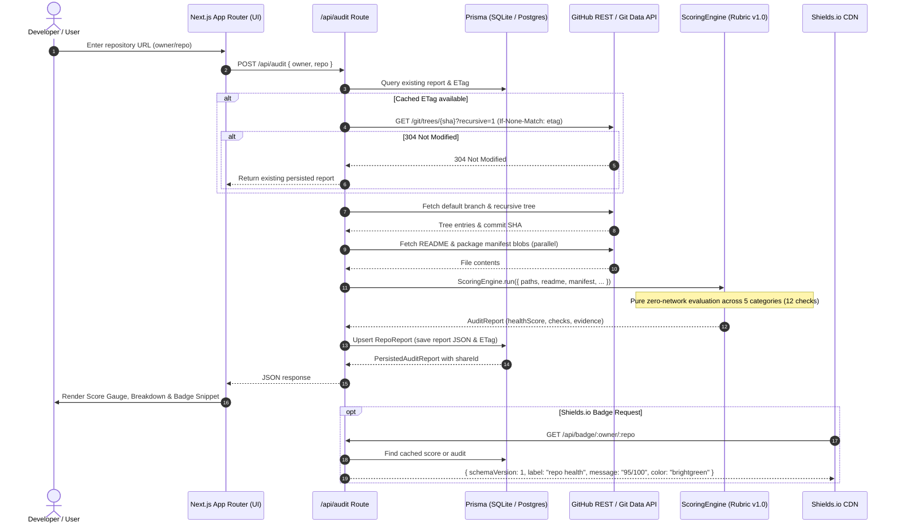

# Repodoc

> **Repository Intelligence & Automated Health Remediation**
> Enter any public GitHub repository URL to instantly generate a 100-point repository health audit with defensible evidence, embeddable shields.io health badges, and shareable report snapshots.

[](https://repodoc.dev)
[](https://nextjs.org/)
[](https://www.typescriptlang.org/)
[](https://tailwindcss.com/)
[](https://www.prisma.io/)
[](https://vitest.dev/)

---

## Table of Contents

- [Overview](#overview)
- [Key Features](#key-features)
- [Architecture Overview](#architecture-overview)
  - [System Flow](#system-flow)
  - [Directory Structure](#directory-structure)
- [Defensible 100-Point Scoring Rubric (v1.0)](#defensible-100-point-scoring-rubric-v10)
- [Shields.io Badge Integration](#shieldsio-badge-integration)
- [Environment Variables](#environment-variables)
- [Installation & Setup](#installation--setup)
  - [Prerequisites](#prerequisites)
  - [Step-by-Step Installation](#step-by-step-installation)
- [GitHub OAuth Setup](#github-oauth-setup)
- [Usage & Development Workflows](#usage--development-workflows)
- [Production Deployment](#production-deployment)
- [Roadmap (Phase 2 Preview)](#roadmap-phase-2-preview)
- [License](#license)

---

## Overview

Repodoc is an engineering-first developer productivity and repository governance platform. Unlike shallow API wrappers or naive prompt bots, Repodoc implements production-grade systems engineering:

1. **Single-Roundtrip Git Tree Traversal:** Resolves 90%+ of repository presence checks in a single recursive call (`GET /repos/{owner}/{repo}/git/trees/{sha}?recursive=1`) and executes in-memory set lookups in `<1ms`.
2. **Defensible, Versioned Scoring Rubric (v1.0):** Replaces vanity proxies (like raw README word counts) with structural AST and markdown heading analysis, project-type awareness (libraries vs. applications), and structured audit evidence.
3. **HTTP Conditional Request Resiliency (`ETag` / `If-None-Match`):** Avoids consuming unauthenticated GitHub rate limits on re-audits when repository trees remain unchanged (`304 Not Modified`).
4. **Standard Shields.io Endpoint API:** Serves lightweight, CDN-cached endpoint JSON directly compliant with shields.io (`schemaVersion: 1`), removing fragile server-side image rendering pipelines.
5. **Persistent & Shareable Snapshots:** Stores report snapshots with unique 8-character nanoid keys (`/share/[shareId]`) alongside live, refreshable repository reports (`/report/[owner]/[repo]`).

---

## Key Features

- **Instant Public Repository Audits:** Paste any public GitHub URL or coordinates (`owner/repo`) into the interactive hero to generate a complete health report.
- **Categorized Breakdown & Evidence:** Inspect pass/fail outcomes, awarded points, files scanned, and concrete remediation instructions across 5 key dimensions: Documentation, Project Hygiene, Testing & CI/CD, Community & Metadata, and Security Baseline.
- **Live Score Gauge & Badge Preview:** Visual score gauge with accessible ARIA meters and an interactive tabbed snippet generator (Markdown, HTML, Raw URL) with 1-click clipboard copy.
- **Dynamic Shields.io Badge API:** Drop `/api/badge/:owner/:repo` directly into your repository README for real-time health grades.
- **Read-Only Shareable Reports:** Generate immutable audit snapshots for team reviews, pull request discussions, or portfolio showcases.
- **Resilient Error Recovery:** Built-in rate limit handling with retry estimation, truncated tree detection, and network error recovery.

---

## Architecture Overview

Repodoc is structured around an event-driven, cache-first architecture that decouples repository fetching, pure rubric scoring, persistence, and presentation.

### System Flow



### Directory Structure

```
Repodoc/
├── app/                          # Next.js App Router
│   ├── api/                      # Serverless API routes
│   │   ├── audit/                # POST /api/audit — run audit & persist
│   │   ├── badge/[owner]/[repo]/ # GET /api/badge/:owner/:repo — shields.io JSON
│   │   └── report/[shareId]/     # GET /api/report/:shareId — query report snapshot
│   ├── report/[owner]/[repo]/    # Live, refreshable report page
│   ├── share/[shareId]/          # Immutable read-only shareable report page
│   ├── layout.tsx                # Root layout with site metadata & JSON-LD
│   ├── page.tsx                  # Landing page & audit input
│   └── opengraph-image.tsx       # Dynamic OG social preview card
├── src/
│   ├── lib/
│   │   ├── scoring/              # Rubric v1.0 Scoring Engine (pure functions)
│   │   │   ├── checks/           # Modular check suites (docs, hygiene, testing, etc.)
│   │   │   ├── engine.ts         # ScoringEngine orchestrator
│   │   │   └── utils.ts          # Tree path set builder & markdown heading parsers
│   │   ├── github/               # GitHub API facade
│   │   │   ├── client.ts         # Octokit wrapper with rate limiting & error codes
│   │   │   └── service.ts        # Tree traversal & file blob fetching
│   │   ├── audit.ts              # End-to-end audit coordinator
│   │   ├── badge.ts              # Shields.io response formatting & color thresholds
│   │   ├── db.ts                 # Prisma singleton client
│   │   ├── reports.ts            # Report persistence & cache lookup
│   │   └── types.ts              # Shared TypeScript interfaces & types
│   └── components/
│       └── report/               # Report UI components (re-exported)
├── components/
│   ├── landing/                  # Landing sections (hero, observatory, bento, steps)
│   ├── report/                   # ScoreGauge, CategoryBreakdown, BadgeSnippet, etc.
│   └── ui/                       # shadcn/ui primitives
├── prisma/
│   ├── schema.prisma             # Data models (RepoReport, User)
│   └── dev.db                    # Local SQLite database (gitignored)
└── vitest.config.ts              # Vitest test runner configuration
```

---

## Defensible 100-Point Scoring Rubric (v1.0)

Every check returns **pure, unit-tested structured data** including scanned file paths, pass/fail status, concrete evidence, and remediation proposals:

| Category                 |   Weight   | Checks Performed                                                                                                                                                                                 |              Points               | Automation Target                                |
| :----------------------- | :--------: | :----------------------------------------------------------------------------------------------------------------------------------------------------------------------------------------------- | :-------------------------------: | :----------------------------------------------- |
| **Documentation**        | **25 pts** | • `README.md` presence<br>• Essential headings (`Installation`/`Setup` & `Usage`/`Quickstart`)<br>• Architecture / Overview description heading<br>• Contributing guidelines (`CONTRIBUTING.md`) | 8 pts<br>10 pts<br>4 pts<br>3 pts | Guided / PR                                      |
| **Project Hygiene**      | **20 pts** | • Valid OSI open-source `LICENSE`<br>• Language-appropriate `.gitignore`<br>• Code of Conduct (`CODE_OF_CONDUCT.md`)                                                                             |     10 pts<br>5 pts<br>5 pts      | **1-Click PR**<br>_(License requires selection)_ |
| **Testing & CI/CD**      | **25 pts** | • Automated CI workflow in `.github/workflows/*.yml`<br>• Test directory or manifest test script (`package.json`, etc.)                                                                          |         15 pts<br>10 pts          | **1-Click PR**<br>_(Generates standard CI)_      |
| **Community & Metadata** | **15 pts** | • Issue / PR templates in `.github/`<br>• Repository description & topics on GitHub                                                                                                              |          8 pts<br>7 pts           | Guided                                           |
| **Security Baseline**    | **15 pts** | • `SECURITY.md` vulnerability reporting policy<br>• Automated dependency scanning (Dependabot / Renovate)                                                                                        |          10 pts<br>5 pts          | **1-Click PR**                                   |

### Design Rules:

- **No Vanity Metrics:** Never scores on word or line counts; scores on structural presence, markdown headings, and configuration.
- **Context Awareness:** Automatically inspects package manifests (`package.json`, `Cargo.toml`, `pyproject.toml`, `go.mod`) to adapt expectations for libraries vs. applications.
- **Legal Prudence:** Never auto-selects a license without user confirmation.

---

## Shields.io Badge Integration

Repodoc complies with the [Shields.io Endpoint Specification](https://shields.io/endpoint), enabling repository owners to embed real-time health badges directly into their project READMEs.

### Endpoint Details

- **Route:** `GET /api/badge/[owner]/[repo]`
- **Response Format:**
  ```json
  {
    "schemaVersion": 1,
    "label": "repo health",
    "message": "95/100",
    "color": "brightgreen"
  }
  ```
- **Caching:** `Cache-Control: public, s-maxage=3600, stale-while-revalidate=86400` (1 hour edge cache with 24-hour background revalidation).

### Color Thresholds

| Health Score |  Badge Color  | Meaning                                                        |
| :----------: | :-----------: | :------------------------------------------------------------- |
| **90 – 100** | `brightgreen` | Excellent documentation, testing, and hygiene                  |
| **75 – 89**  |    `green`    | Solid foundation; minor improvements recommended               |
| **60 – 74**  |   `yellow`    | Moderate health; missing key workflows or documentation        |
| **40 – 59**  |   `orange`    | Deficient; missing critical security or testing infrastructure |
|  **0 – 39**  |     `red`     | Critical baseline gaps                                         |

### Embed Snippets

Replace `{owner}` and `{repo}` with your GitHub repository coordinates:

**Markdown:**

```markdown
[](https://repodoc.dev/report/{owner}/{repo})
```

**HTML:**

```html
<a href="https://repodoc.dev/report/{owner}/{repo}">
  
</a>
```

---

## Environment Variables

Repodoc uses a minimal set of environment variables. Copy `.env.example` to `.env` to get started:

```bash
cp .env.example .env
```

| Variable               |    Required     | Default               | Description                                                                                                                                                                                |
| :--------------------- | :-------------: | :-------------------- | :----------------------------------------------------------------------------------------------------------------------------------------------------------------------------------------- |
| `DATABASE_URL`         |     **Yes**     | `file:./dev.db`       | Connection string for Prisma. Uses SQLite locally (`file:./dev.db`) and PostgreSQL in production (`postgresql://...`).                                                                     |
| `GITHUB_TOKEN`         |   _Optional_    | `""`                  | GitHub Personal Access Token (classic or fine-grained with `public_repo` read access). Highly recommended in development to elevate GitHub API rate limits from 60 req/hr to 5,000 req/hr. |
| `NEXT_PUBLIC_SITE_URL` |   _Optional_    | `https://repodoc.dev` | Canonical public origin used for generating full share URLs, OpenGraph social cards, and badge endpoint links. Set to `http://localhost:3000` during local testing if needed.              |
| `NEXTAUTH_SECRET`      | **For sign-in** | None                  | Random secret used to encrypt NextAuth session cookies. Generate with `openssl rand -base64 32`.                                                                                           |
| `NEXTAUTH_URL`         | **For sign-in** | None                  | Canonical origin, e.g. `http://localhost:3000` locally or `https://repodoc.dev` in production. Do not include `/api/auth`, query parameters, or credentials.                               |
| `GITHUB_CLIENT_ID`     | **For sign-in** | None                  | Client ID from the GitHub OAuth App registration.                                                                                                                                          |
| `GITHUB_CLIENT_SECRET` | **For sign-in** | None                  | Client secret from the same GitHub OAuth App. Keep server-side.                                                                                                                            |

---

## Installation & Setup

Follow these steps to clone, configure, and run Repodoc locally on your machine.

### Prerequisites

- **Node.js:** `v20.x` or higher (or **Bun** `v1.1+` / **pnpm** `v9+`)
- **Git**
- A GitHub account (if generating an optional Personal Access Token)

### Step-by-Step Installation

1. **Clone the repository:**

   ```bash
   git clone https://github.com/<your-username>/Repodoc.git
   cd Repodoc
   ```

2. **Install dependencies:**
   Using [Bun](https://bun.sh/) (recommended):

   ```bash
   bun install
   ```

   Or using npm / pnpm:

   ```bash
   npm install
   # or: pnpm install
   ```

3. **Configure environment variables:**

   ```bash
   cp .env.example .env
   ```

   _(Optional)_ Open `.env` and add your GitHub token to `GITHUB_TOKEN="ghp_..."` to avoid unauthenticated rate limits while testing.

4. **Initialize the local database:**
   Run Prisma's schema push to generate the SQLite database file (`prisma/dev.db`) and compile the `@prisma/client`:

   ```bash
   npx prisma db push
   ```

5. **Start the development server:**

   ```bash
   bun dev
   # or: npm run dev
   ```

6. **Open the application:**
   Navigate to [http://localhost:3000](http://localhost:3000) in your browser.
   - Enter any public repository (e.g., `facebook/react`, `vercel/next.js`, or `octocat/Hello-World`) to test the audit engine.
   - Inspect the live report at `http://localhost:3000/report/octocat/Hello-World`.
   - Test the badge endpoint at `http://localhost:3000/api/badge/octocat/Hello-World`.

---

## GitHub OAuth Setup

The OAuth backend uses NextAuth.js v5 (`5.0.0-beta.32`, pinned for Next.js 16 / React 19 compatibility). Public audits work without OAuth configuration; auth endpoints return a sanitized configuration error until all four sign-in variables above are set. The landing, report, and share headers provide GitHub sign-in and an avatar menu with sign-out. On small screens, the sign-in control uses an icon with an accessible label.

1. In GitHub **Settings → Developer settings → OAuth Apps → New OAuth App**, [register an OAuth App](https://docs.github.com/en/apps/oauth-apps/building-oauth-apps/creating-an-oauth-app). This task uses an OAuth App; GitHub App installation setup is separate.
2. For local development, set **Homepage URL** to `http://localhost:3000` and **Authorization callback URL** to `http://localhost:3000/api/auth/callback/github`.
3. Copy the app's client ID and generated client secret into the gitignored `.env` as `GITHUB_CLIENT_ID` and `GITHUB_CLIENT_SECRET`. Generate a secret with `openssl rand -base64 32`, save it as `NEXTAUTH_SECRET`, and set `NEXTAUTH_URL="http://localhost:3000"`. Keep this secret stable across restarts so existing sessions remain readable. Restart the development server after changing environment variables.
4. Create a **separate OAuth App for production** with homepage `https://<your-domain>` and callback `https://<your-domain>/api/auth/callback/github`. Configure that app's credentials, a separate session secret, and the HTTPS `NEXTAUTH_URL` in the deployment environment. Use the matching origin when opening the app; plain HTTP is permitted only for local development.

The authorization request asks for `read:user user:email public_repo workflow`. Profile/email scopes support GitHub identity, including private email addresses. `public_repo` enables public-repository changes and PRs; `workflow` enables creation of CI workflow files. OAuth scopes are requested by the application during consent, rather than selected in the OAuth App registration. These scopes grant substantial write access to public repositories and workflows, subject to the user's own permissions; private repository access via `repo` is not requested. See [GitHub's scope definitions](https://docs.github.com/en/apps/oauth-apps/building-oauth-apps/scopes-for-oauth-apps). Signing in alone does not perform repository writes.

To verify the setup manually:

1. Start the app and use **Sign in with GitHub** in a page header. Complete GitHub login/consent and confirm you return to the same page, including its query string and fragment. The [built-in sign-in page](http://localhost:3000/api/auth/signin) is also available.
2. Open [the session endpoint](http://localhost:3000/api/auth/session). It should contain `user.id` (the database ID), `user.githubId`, `user.username`, standard profile fields, and an expiry, with **no access token**. Refresh and restart the server; the session should persist with the same secret.
3. Run `bunx prisma studio` and confirm one `User` record exists. Sign in again and confirm that the existing record is updated, preserving installation and report associations.
4. Open the header avatar menu, confirm it identifies your GitHub username, and choose **Sign out**. Confirm you return to the same page, the sign-in control reappears, and the session endpoint returns `null`. The [built-in sign-out page](http://localhost:3000/api/auth/signout) is also available.

The shared client session provider fetches only the public session after hydration, preserving the static landing page. Authentication status synchronizes on window focus and across tabs. Account menus support keyboard navigation and remain inside the report's light/dark theme scope. Missing or failed avatar images fall back to username initials. Rejected sign-in/out requests show a generic error and allow retry without displaying provider payloads.

On a live report with failing automatable findings (`license`, `gitignore`, `ci-workflow`, `security-policy`, `code-of-conduct`), **Fix All** is enabled after authentication. Clicking **Fix All** opens a configuration dialog displaying available fixes pre-selected with their names, descriptions, and target file paths. Submitting requires at least one selected fix. Selecting `license` requires entering a nonblank, single-line copyright holder, and selecting `code-of-conduct` requires entering a nonblank, single-line incident-reporting contact. Template inputs are never inferred from the signed-in account. If `license` is selected, continuing transitions to the License Selector dialog where users explicitly choose from 5 supported licenses (MIT, Apache-2.0, BSD-3-Clause, GPL-3.0, MPL-2.0) before confirmation; cancellation returns to the configuration dialog without sending a request. If `license` is not selected, the request submits directly.

Form inputs freeze during pending requests, and users can close the dialog while background remediation continues; an accessible status message next to the trigger button displays in-progress feedback. On completion, a persistent link to the created GitHub pull request and list of created files are displayed, with a reminder that audited scores update only after merging and re-auditing. Errors display actionable guidance for authentication, permissions/scopes, conflicts, and rate limits (honoring `Retry-After` countdowns). Shared snapshots remain read-only, and score previews do not affect remediation. Re-auditing is disabled during active remediation, and Fix All is disabled during active audits. The gate controls presentation only: the remediation API independently authorizes the server session using `getGitHubSession()`.

To verify the UI, check both landing navigation layouts and the live/share headers. Confirm Fix All is hidden while loading, signed out, or when no failing automatable findings exist; enabled when eligible and signed in; and absent from shared snapshots. Check modal transitions, focus restoration, keyboard navigation, light/dark themes, retry timers, and error guidance. Run `bun run test:run components/report/__tests__/fix-button.test.tsx components/report/__tests__/license-selector.test.tsx src/lib/__tests__/request-remediation.test.ts components/report/__tests__/remediation-flow.integration.test.tsx --maxWorkers=1` for automated coverage.

Sessions use encrypted, HttpOnly cookies with a 30-day lifetime; HTTPS deployments also use Secure cookies. Database user records contain identity fields only. The GitHub access token stays in encrypted JWT claims and is omitted from browser-readable session responses. Server code can call `getGitHubSession()` from `@/lib/auth` to obtain `{ userId, githubId, username, accessToken }`, or `null` when credentials are missing, invalid, or expired. Never pass this result to a Client Component or return it from an API. `auth()` from `@/auth` returns the public session without credentials. Client session updates cannot overwrite trusted identity or token claims. Provider expiry is honored if supplied; revoked tokens or expired credentials require signing in again. Automatic token refresh is not implemented.

Automated OAuth tests use mocked GitHub responses and a temporary SQLite database; they do not require real credentials. Run `bun run test:run lib/auth/__tests__`. GitHub registration and a real browser consent flow must still be verified before marking task 2.0.1 complete.

### Remediation API

`POST /api/remediate` requires a valid GitHub session cookie and `Content-Type: application/json`. The server reads the user's GitHub token from the encrypted session; request-body credentials and the environment's `GITHUB_TOKEN` cannot override it. Browser requests must have the same origin as the endpoint. Direct API clients may omit `Origin`, but still need a session cookie.

```json
{
  "owner": "your-account",
  "repo": "your-test-repository",
  "fixes": ["license", "gitignore", "ci-workflow"],
  "licenseChoice": "MIT",
  "licenseFullName": "Your explicit copyright holder"
}
```

Supply repository names rather than URLs. Surrounding whitespace is trimmed, and duplicate fixes are applied once in selection order. Supported check IDs are `license`, `gitignore`, `ci-workflow`, `security-policy`, and `code-of-conduct`. At least one is required, and each selected check must fail and be automatable in the fresh server-side audit.

| Field                  | Requirement                                                                                                                                               |
| :--------------------- | :-------------------------------------------------------------------------------------------------------------------------------------------------------- |
| `licenseChoice`        | Required for `license`: `MIT`, `Apache-2.0`, `BSD-3-Clause`, `GPL-3.0-only` (also accepts `GPL-3.0`), or `MPL-2.0`. No license is selected automatically. |
| `licenseFullName`      | Required for `license`: explicit nonblank, single-line copyright holder. The engine uses the current UTC year.                                            |
| `codeOfConductContact` | Required for `code-of-conduct`: explicit nonblank, single-line incident-reporting contact, such as `conduct@example.com`.                                 |

Optional template fields must be valid when supplied. Attribution and reporting contacts are never inferred from the signed-in identity.

The handler performs a fresh authenticated audit without updating saved reports, then the engine rechecks the exact base commit's complete tree before generating files. It skips findings resolved since the audit, preserves existing files, and creates one atomic commit on `repodoc/health-remediation`, opening or reusing its PR. Updating that generated branch replaces its history. When the caller has explicit GitHub push permission, writes go directly to that repository. Otherwise, the engine automatically requests or reuses a personal fork and opens a cross-fork PR against the audited upstream repository.

The fork flow validates caller ownership, write access, and the repository network, then waits up to 15 seconds for the exact upstream base commit and tree to become accessible in the fork. Existing renamed forks use their returned coordinates. A stale or divergent fork does not contribute unrelated commits: remediation uses the upstream snapshot and parent commit. Only the generated `repodoc/health-remediation` branch is created or replaced; the fork's default branch and other branches remain unchanged. Forks whose default branch is the generated branch are rejected. Missing push-permission metadata fails closed.

If preparation exceeds the readiness window, the API returns HTTP 503 with `Retry-After: 15`; submit the same request again to reuse the fork. Authentication, permissions, rate limits, and invalid responses fail immediately during readiness checks. Fork creation can still be denied by GitHub policies or OAuth scopes. No organization-fork selection or background job is provided.

Successful HTTP 200 response:

```json
{
  "prUrl": "https://github.com/your-account/your-test-repository/pull/42",
  "filesCreated": ["LICENSE", ".gitignore", ".github/workflows/ci.yml"]
}
```

Every response uses `Cache-Control: no-store`. Errors contain only `{ "error": "..." }` with a safe message:

| Status | Meaning                                                                                                                                    |
| :----- | :----------------------------------------------------------------------------------------------------------------------------------------- |
| 400    | Invalid JSON, repository coordinates, fix selection, or template inputs; also covers selected findings already passing in the fresh audit. |
| 401    | Missing/expired session or GitHub credentials rejected; sign in again. Authentication is checked first.                                    |
| 403    | Cross-origin request or insufficient GitHub permissions/OAuth scopes.                                                                      |
| 404    | Repository or GitHub resource missing or inaccessible.                                                                                     |
| 409    | Conflicting destination/parent path, all selections resolved between audit and write preparation, or an unsafe/unrelated fork.             |
| 415    | Missing or unsupported JSON content type.                                                                                                  |
| 429    | GitHub rate limit; includes `Retry-After` when valid timing is available.                                                                  |
| 502    | Incomplete repository tree or another GitHub/network failure.                                                                              |
| 503    | Fork preparation is still pending; includes `Retry-After: 15`. Resubmit after waiting.                                                     |
| 500    | Unexpected internal failure.                                                                                                               |

Run `bun run test:run app/api/remediate --maxWorkers=1` for route validation and real audit/engine integration against mocked GitHub HTTP responses. Live acceptance remains pending: use a signed-in session against a disposable repository with known missing files, submit the request, and verify the returned PR, single commit, and added files. A real request creates GitHub objects; automated tests mock these writes. For fork acceptance, sign in as a user without upstream write access, use a disposable upstream repository, and verify that the PR targets upstream while its head is the caller's fork. Confirm one commit, the expected added files, no changes to fork default/other branches, and reuse of the same PR on a repeated submission while the findings remain unresolved.

---

## Usage & Development Workflows

| Command                                 | Tool       | Description                                                             |
| :-------------------------------------- | :--------- | :---------------------------------------------------------------------- |
| `bun dev` / `npm run dev`               | Next.js    | Start local dev server with Turbopack at `localhost:3000`               |
| `bun run test:run` / `npm run test:run` | Vitest     | Run the complete automated test suite (980+ unit and integration tests) |
| `bun run test` / `npm test`             | Vitest     | Run Vitest in interactive watch mode                                    |
| `bun run lint` / `npm run lint`         | ESLint     | Run ESLint checks against all TypeScript and React files                |
| `npx tsc --noEmit`                      | TypeScript | Run complete project type-checking                                      |
| `bun run build` / `npm run build`       | Next.js    | Create an optimized production build                                    |
| `bun run start` / `npm run start`       | Next.js    | Start production server locally after building                          |
| `npx prisma studio`                     | Prisma     | Open visual database browser for local SQLite records                   |
| `npx prisma db push`                    | Prisma     | Sync schema changes directly to local database                          |

---

## Production Deployment

### Recommended Platform: Vercel

1. **Database Configuration:**
   - SQLite is **not** supported in serverless production environments (such as Vercel) due to the ephemeral container filesystem.
   - Provision a managed PostgreSQL instance (e.g. [Neon](https://neon.tech), [Supabase](https://supabase.com), or [Railway](https://railway.app)).
   - In `prisma/schema.prisma`, update the provider to `postgresql` when deploying:
     ```prisma
     datasource db {
       provider = "postgresql"
       url      = env("DATABASE_URL")
     }
     ```
   - Execute migrations against your production database:
     ```bash
     npx prisma migrate deploy
     # or: npx prisma db push
     ```

2. **Environment Variables in Vercel:**
   Configure the following in your Vercel Project Settings:
   - `DATABASE_URL`: Your PostgreSQL connection string.
   - `GITHUB_TOKEN`: A GitHub PAT with read-only access for elevated rate limits.
   - `NEXT_PUBLIC_SITE_URL`: Your production domain (e.g., `https://repodoc.dev`).
   - For GitHub sign-in: `NEXTAUTH_SECRET`, HTTPS `NEXTAUTH_URL`, `GITHUB_CLIENT_ID`, and `GITHUB_CLIENT_SECRET` from the production OAuth App described above.

3. **Deploy:**
   Push your repository to GitHub and link it to Vercel for automated deployments on push.

---

## Roadmap (Phase 2 Preview)

The next phase of Repodoc focuses on automated remediation:

- **GitHub App & OAuth Integration:** Authenticate users and verify repository write permissions.
- **1-Click Atomic PR Remediation ("Fix All"):**
  - Generates missing open-source licenses, `.gitignore`, minimal CI test workflows, and `SECURITY.md`.
  - Commits all files in a **single atomic commit** directly via the Git Data API (`POST /git/blobs` → `POST /git/trees` → `POST /git/commits`).
  - Opens a clean pull request on a dedicated idempotent branch (`repodoc/health-remediation`).
  - Automatic fork orchestration when users lack direct push access.

---

## License

This project is licensed under the MIT License. See [LICENSE](LICENSE) for details.
