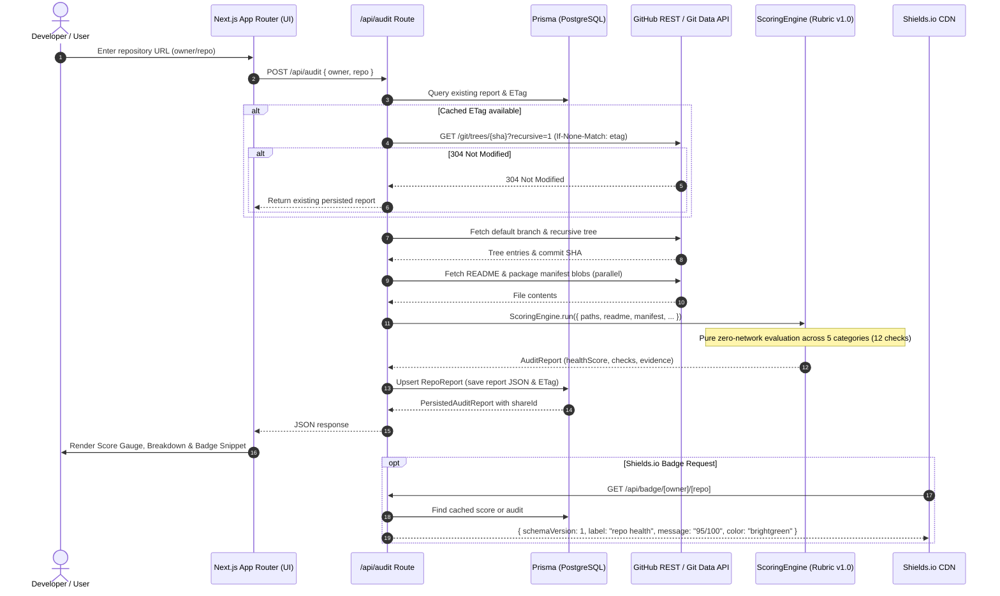

# Repodoc

> **Repository Intelligence, Defensible Health Audits & Automated 1-Click Remediation**  
> Enter any public GitHub repository to instantly generate a comprehensive 100-point health audit with verifiable AST evidence, embeddable Shields.io badges, user dashboard analytics, and 1-click atomic pull request remediation.

[](https://repodoc.dev)
[](https://nextjs.org/)
[](https://react.dev/)
[](https://www.typescriptlang.org/)
[](https://tailwindcss.com/)
[](https://bun.sh/)
[](https://www.prisma.io/)
[-6E9F18?logo=vitest)](https://vitest.dev/)
[](LICENSE)

---

## Table of Contents

- [Overview](#overview)
- [Key Features](#key-features)
- [Architecture Overview](#architecture-overview)
  - [System Sequence Flow](#system-sequence-flow)
  - [Repository Structure](#repository-structure)
- [5-Minute Quickstart](#5-minute-quickstart)
  - [Prerequisites](#prerequisites)
  - [Step-by-Step Setup](#step-by-step-setup)
- [Defensible 100-Point Scoring Rubric (v1.0)](#defensible-100-point-scoring-rubric-v10)
- [Shields.io Badge Integration](#shieldsio-badge-integration)
- [Environment Variables](#environment-variables)
- [Development Workflow Commands](#development-workflow-commands)
- [Documentation Index](#documentation-index)
- [License](#license)

---

## Overview

Repodoc is an engineering-first developer productivity and repository governance platform. Unlike shallow API wrappers or naive prompt bots, Repodoc implements production-grade systems engineering:

1. **Single-Roundtrip Git Tree Traversal:** Resolves 90%+ of repository presence checks in a single recursive call (`GET /repos/{owner}/{repo}/git/trees/{sha}?recursive=1`) and executes in-memory set lookups in `<1ms`.
2. **Defensible, Versioned Scoring Rubric (v1.0):** Replaces vanity proxies (like raw README word counts) with structural AST and markdown heading analysis, project-type awareness (libraries vs. applications), and structured audit evidence.
3. **HTTP Conditional Request Resiliency (`ETag` / `If-None-Match`):** Avoids consuming unauthenticated GitHub rate limits on re-audits when repository trees remain unchanged (`304 Not Modified`).
4. **Standard Shields.io Endpoint API:** Serves lightweight, CDN-cached endpoint JSON directly compliant with shields.io (`schemaVersion: 1`), removing fragile server-side image rendering pipelines.
5. **Zero-Leak NextAuth.js v5 Authentication:** Stores GitHub provider access tokens strictly in AES-GCM encrypted, HTTP-only JWT cookies on the server; public session payloads never expose OAuth tokens.
6. **1-Click Atomic PR Remediation ("Fix All"):** Generates missing open-source licenses, `.gitignore`, minimal CI test workflows, `SECURITY.md`, and `CODE_OF_CONDUCT.md`, committing all selected fixes in a single atomic Git commit via low-level Git Data API with automatic personal fork fallback.
7. **User Repository Dashboard:** Centralized repository management at `/dashboard` tracking analyzed repositories, health score histories, and 1-click re-audit triggers.

---

## Key Features

- **Instant Public Repository Audits:** Paste any public GitHub URL or coordinates (`owner/repo`) into the interactive hero to generate a complete health report.
- **Defensible 100-Point Rubric v1.0:** Inspect pass/fail outcomes, awarded points, files scanned, and concrete remediation instructions across 5 key dimensions: Documentation, Project Hygiene, Testing & CI/CD, Community & Metadata, and Security Baseline.
- **Dynamic Shields.io Badge API:** Drop `/api/badge/[owner]/[repo]` directly into your repository README for real-time health grades backed by edge CDN caching.
- **User Dashboard (`/dashboard`):** Track all previously audited repositories, monitor health score progression, and trigger immediate re-audits with a single click.
- **1-Click Atomic PR Remediation ("Fix All"):** Authenticated users can generate and commit missing health assets in a single atomic Git commit (`POST /git/blobs` → `POST /git/trees` → `POST /git/commits`) with automatic personal fork fallback when push access is unavailable.
- **Read-Only Shareable Reports:** Generate immutable audit snapshots with unique 8-character nanoid keys (`/share/[shareId]`) for team reviews, pull request discussions, or portfolio showcases.
- **Resilient Error Recovery:** Built-in rate limit handling with retry estimation, truncated tree detection, and network error recovery.

---

## Architecture Overview

Repodoc is structured around an event-driven, cache-first architecture that decouples repository fetching, pure rubric scoring, persistence, authentication, and presentation.

### System Sequence Flow



### Repository Structure

```
Repodoc/
├── app/                          # Next.js App Router pages & API routes
│   ├── api/                      # Route handlers (/api/audit, /api/badge, /api/remediate, /api/auth)
│   ├── dashboard/                # User repository dashboard & audit management
│   ├── report/[owner]/[repo]/    # Live, refreshable repository health report
│   ├── share/[shareId]/          # Immutable read-only shareable audit snapshot
│   ├── layout.tsx                # Root layout with site metadata, fonts & providers
│   ├── page.tsx                  # Interactive landing page & repository audit input
│   └── opengraph-image.tsx       # Dynamic OG social preview card generator
├── components/                   # React components
│   ├── auth/                     # GitHub OAuth sign-in controls & user menus
│   ├── dashboard/                # Dashboard repo cards, summary metrics & toolbar
│   ├── landing/                  # Landing sections (hero, observatory, bento, steps)
│   ├── report/                   # ScoreGauge, CategoryBreakdown, BadgeSnippet, FixButton
│   └── ui/                       # Accessible UI primitives (@base-ui/react & Tailwind v4)
├── docs/                         # In-depth architectural & operational documentation
│   ├── architecture.md           # System topology, scoring engine & sequence diagrams
│   ├── authentication.md         # NextAuth v5, OAuth App setup & zero-leak token model
│   ├── database.md               # Prisma schema, PostgreSQL setup & migration runbook
│   ├── deployment.md             # Vercel deployment, security headers (CSP) & production checklist
│   └── remediation-engine.md     # Git Data API atomic commits, templates & fork fallback
├── lib/                          # Core business logic & server-side utilities
│   ├── auth/                     # Auth.js configuration, callbacks & encrypted session claims
│   ├── github/                   # Octokit REST client & recursive Git tree traversal
│   ├── remediation/              # Atomic Git Data API orchestration & personal fork manager
│   ├── scoring/                  # Pure Rubric v1.0 scoring engine & check modules
│   ├── templates/                # License, CI workflow, .gitignore & community templates
│   ├── audit.ts                  # End-to-end repository audit orchestrator
│   ├── badge.ts                  # Shields.io endpoint schema formatting & color thresholds
│   ├── dashboard.ts              # User dashboard data fetching & repository aggregation
│   ├── db.ts                     # Prisma client singleton instance
│   └── reports.ts                # Report persistence, nanoid shareId generation & ETag caching
├── prisma/
│   ├── schema.prisma             # Local SQLite models (User, RepoReport)
│   └── production/               # PostgreSQL schema and versioned migrations
├── types/                        # Global ambient and shared TypeScript definitions
├── auth.ts                       # NextAuth.js v5 route handler & auth() export
├── next.config.ts                # Next.js 16 configuration with strict CSP & security headers
├── package.json                  # Dependencies & package scripts
└── vitest.config.mts             # Vitest test runner configuration
```

---

## 5-Minute Quickstart

Follow these steps to clone, configure, and run Repodoc locally on your machine in under 5 minutes.

### Prerequisites

- **Node.js:** `24.x` and **Bun:** `1.4.3`
- **PostgreSQL:** `18` (Docker Compose is provided)
- **Git**
- A modern web browser

### Step-by-Step Setup

1. **Clone the repository:**

   ```bash
   git clone https://github.com/<your-username>/Repodoc.git
   cd Repodoc
   ```

2. **Install dependencies:**

   Using [Bun](https://bun.sh/) (recommended):

   ```bash
   bun install
   ```

   Or using npm:

   ```bash
   npm install
   ```

3. **Configure environment variables:**

   Copy the provided environment template:

   ```bash
   cp .env.example .env
   ```

   > [!NOTE]
   > **Zero Tokens Required for Public Audits:** Repodoc is designed to work immediately out-of-the-box! Public repository audits, the defensible scoring engine, and Shields.io badges function with zero external credentials.
   > 
   > Setting `GITHUB_TOKEN` in `.env` is optional but recommended in development to elevate GitHub API rate limits from 60 req/hr to 5,000 req/hr. Setting GitHub OAuth credentials (`GITHUB_CLIENT_ID`, `GITHUB_CLIENT_SECRET`, `NEXTAUTH_SECRET`, `NEXTAUTH_URL`) is only required if you wish to test user sign-in, the user dashboard, or 1-click remediation.

4. **Initialize the local database:**

   Start PostgreSQL 18 and apply the committed migrations (requires Docker):

   ```bash
   docker compose up -d --wait
   bun run db:generate
   bun run db:migrate
   ```

5. **Start the development server:**

   ```bash
   bun dev
   # or: npm run dev
   ```

6. **Verify in your browser:**

   Open [http://localhost:3000](http://localhost:3000) in your browser:
   - Enter any public repository (e.g. `facebook/react`, `vercel/next.js`, or `octocat/Hello-World`) to test the audit engine.
   - Inspect the live report at [http://localhost:3000/report/octocat/Hello-World](http://localhost:3000/report/octocat/Hello-World).
   - Test the dynamic badge endpoint at [http://localhost:3000/api/badge/octocat/Hello-World](http://localhost:3000/api/badge/octocat/Hello-World).

---

## Defensible 100-Point Scoring Rubric (v1.0)

Every audit executes in memory without network side-effects, returning structured data with scanned paths, pass/fail status, concrete evidence, and remediation proposals:

| Category | Weight | Checks Performed | Points | Automation Target |
| :--- | :---: | :--- | :---: | :--- |
| **Documentation** | **25 pts** | • `README.md` presence<br>• Essential headings (`Installation`/`Setup` & `Usage`/`Quickstart`)<br>• Architecture / Overview description heading<br>• Contributing guidelines (`CONTRIBUTING.md`) | 8 pts<br>10 pts<br>4 pts<br>3 pts | Guided / PR |
| **Project Hygiene** | **20 pts** | • Valid OSI open-source `LICENSE`<br>• Language-appropriate `.gitignore`<br>• Code of Conduct (`CODE_OF_CONDUCT.md`) | 10 pts<br>5 pts<br>5 pts | **1-Click PR**<br>_(License requires explicit choice)_ |
| **Testing & CI/CD** | **25 pts** | • Automated CI workflow in `.github/workflows/*.yml`<br>• Test directory or manifest test script (`package.json`, etc.) | 15 pts<br>10 pts | **1-Click PR**<br>_(Tailored to detected runtime)_ |
| **Community & Metadata** | **15 pts** | • Issue / PR templates in `.github/`<br>• Repository description & topics on GitHub | 8 pts<br>7 pts | Guided |
| **Security Baseline** | **15 pts** | • `SECURITY.md` vulnerability reporting policy<br>• Automated dependency scanning (Dependabot / Renovate) | 10 pts<br>5 pts | **1-Click PR** |

### Core Design Rules

- **No Vanity Metrics:** Never scores on arbitrary word or line counts; scores on structural presence, markdown AST headings, and configuration files.
- **Context Awareness:** Automatically inspects package manifests (`package.json`, `Cargo.toml`, `pyproject.toml`, `go.mod`) to adapt expectations for libraries vs. applications.
- **Legal Prudence:** Never auto-assigns an open-source license without explicit user confirmation of license type and copyright holder.

For complete scoring rules and evidence structures, see [docs/architecture.md](docs/architecture.md).

---

## Shields.io Badge Integration

Repodoc complies with the [Shields.io Endpoint Specification](https://shields.io/endpoint), enabling repository owners to embed real-time health badges directly into their project READMEs.

### Endpoint Details

- **Route:** `GET /api/badge/[owner]/[repo]`
- **Response Format:**
  ```json
  {
    "schemaVersion": 1,
    "label": "repo health",
    "message": "95/100",
    "color": "brightgreen"
  }
  ```
- **Caching:** `Cache-Control: public, s-maxage=3600, stale-while-revalidate=86400` (1 hour edge CDN cache with 24-hour background revalidation).

### Color Thresholds

| Health Score | Badge Color | Meaning |
| :---: | :---: | :--- |
| **90 – 100** | `brightgreen` | Excellent documentation, testing, and hygiene |
| **75 – 89** | `green` | Solid foundation; minor improvements recommended |
| **60 – 74** | `yellow` | Moderate health; missing key workflows or documentation |
| **40 – 59** | `orange` | Deficient; missing critical security or testing infrastructure |
| **0 – 39** | `red` | Critical baseline gaps |

### Embed Snippets

Replace `{owner}` and `{repo}` with your GitHub repository coordinates:

**Markdown:**

```markdown
[](https://repodoc.dev/report/{owner}/{repo})
```

**HTML:**

```html
<a href="https://repodoc.dev/report/{owner}/{repo}">
  
</a>
```

---

## Environment Variables

Repodoc uses a minimal, validated set of environment variables. Copy `.env.example` to `.env` to get started:

```bash
cp .env.example .env
```

| Variable | Required | Default | Description |
| :--- | :---: | :--- | :--- |
| `DATABASE_URL` | **Yes** | Local PostgreSQL URL | Runtime connection; use pooled PostgreSQL in production. |
| `DIRECT_URL` | **Yes** | Local PostgreSQL URL | Direct connection for Prisma migrations. |
| `TEST_DATABASE_URL` | **For integration tests** | Local disposable PostgreSQL URL | Direct test connection; never use production credentials. |
| `NEXT_PUBLIC_SITE_URL` | _Optional_ | `https://repodoc.dev` | Canonical public origin used for generating full share URLs, OpenGraph social cards, and badge endpoint links. |
| `GITHUB_TOKEN` | _Optional_ | `""` | GitHub Personal Access Token (classic or fine-grained with `public_repo` read access). Elevates GitHub API rate limits from 60 req/hr to 5,000 req/hr. |
| `NEXTAUTH_SECRET` | **For sign-in** | None | 32-byte base64 secret used to encrypt session cookies. Generate with `openssl rand -base64 32`. Alias: `AUTH_SECRET`. |
| `NEXTAUTH_URL` | **For sign-in** | `http://localhost:3000` | Canonical origin for authentication callbacks (`http://localhost:3000` locally, HTTPS domain in prod). Alias: `AUTH_URL`. |
| `GITHUB_CLIENT_ID` | **For sign-in** | None | Client ID from your registered GitHub OAuth App. Must **NOT** begin with `Iv`. Alias: `AUTH_GITHUB_ID`. |
| `GITHUB_CLIENT_SECRET` | **For sign-in** | None | Client Secret from your registered GitHub OAuth App. Alias: `AUTH_GITHUB_SECRET`. |

> [!CAUTION]
> **Security Notice:** NEVER commit real secrets, tokens, or private credentials to version control. Production secrets must be configured via platform secret managers (e.g. Vercel Project Settings).
> 
> When setting up GitHub OAuth, you **must register an OAuth App**, NOT a GitHub App. GitHub App client IDs begin with `Iv` and are rejected before sign-in. For step-by-step registration instructions, refer to [docs/authentication.md](docs/authentication.md).

---

## Development Workflow Commands

Use Node 24 and Bun 1.4.3. Integration tests require `TEST_DATABASE_URL` for disposable PostgreSQL schemas. Install Chromium with `bunx playwright install chromium`. Run `bun run build` before `bun run test:e2e`. The live GitHub integration is opt-in with `RUN_GITHUB_INTEGRATION=1`. See [deployment verification](docs/deployment.md) for the ordered gates.

All essential development, testing, database, and quality assurance commands:

| Command | Tool | Description |
| :--- | :--- | :--- |
| `bun dev` / `npm run dev` | Next.js 16 | Start local development server with Turbopack at `http://localhost:3000` |
| `bun run test:run` / `npm run test:run` | Vitest | Run complete automated test suite (unit and integration tests) |
| `bun run test` / `npm test` | Vitest | Start Vitest test runner in interactive watch mode |
| `bun run lint` / `npm run lint` | ESLint 9 | Run ESLint static analysis across all TypeScript and React files |
| `bun run typecheck` | TypeScript 5 | Run complete project type-checking without emitting artifacts |
| `bun run build` / `npm run build` | Next.js 16 | Create an optimized production build |
| `bun run start` / `npm run start` | Next.js 16 | Start the production server locally after running `build` |
| `npx prisma studio` | Prisma 6 | Open visual database browser for PostgreSQL records |
| `bun run db:migrate` | Prisma 6 | Apply committed PostgreSQL migrations |
| `bun run db:status` | Prisma 6 | Check migration deployment status |
| `bun run test:unit` | Vitest | Run unit and component tests without a database |
| `bun run test:integration` | Vitest | Run integration tests; requires `TEST_DATABASE_URL` |
| `bun run test:e2e` | Playwright | Run Chromium smoke tests against a completed production build |

---

## Documentation Index

For in-depth architectural guides, operational runbooks, and subsystem specifications, consult the dedicated guides in `docs/`:

| Guide | Scope & Key Topics Covered |
| :--- | :--- |
| [docs/architecture.md](docs/architecture.md) | System topology, Next.js 16 App Router layout, pure Rubric v1.0 scoring engine, conditional ETag caching, and audit sequence diagrams. |
| [docs/authentication.md](docs/authentication.md) | NextAuth.js v5 beta architecture, GitHub OAuth App registration, requested scopes (`read:user`, `user:email`, `public_repo`, `workflow`), server-side AES-GCM token isolation, and session invalidation. |
| [docs/database.md](docs/database.md) | Prisma schema models (`User`, `RepoReport`), PostgreSQL development setup, versioned migrations, and disposable integration test schemas. |
| [docs/remediation-engine.md](docs/remediation-engine.md) | 1-click atomic PR remediation pipeline ("Fix All"), Git Data API orchestration (`blobs` → `trees` → `commits` → `refs`), automated personal fork fallback, and template synthesis heuristics. |
| [docs/deployment.md](docs/deployment.md) | Production Vercel deployment runbook, pre-flight verification checklist, Content Security Policy (CSP) & HTTP security headers, and post-deployment smoke tests. |

---

## License

This project is licensed under the MIT License. See [LICENSE](LICENSE) for details.
