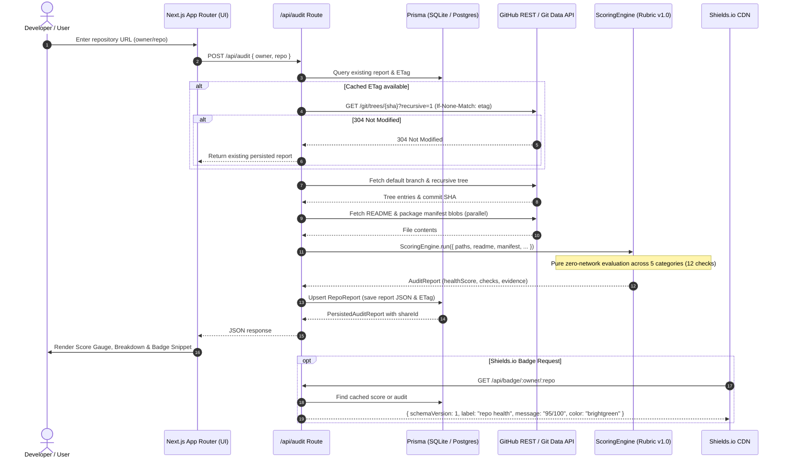

# Repodoc

> **Repository Intelligence & Automated Health Remediation**
> Enter any public GitHub repository URL to instantly generate a 100-point repository health audit with defensible evidence, embeddable shields.io health badges, and shareable report snapshots.

[](https://repodoc.dev)
[](https://nextjs.org/)
[](https://www.typescriptlang.org/)
[](https://tailwindcss.com/)
[](https://www.prisma.io/)
[](https://vitest.dev/)

---

## Table of Contents

- [Overview](#overview)
- [Key Features](#key-features)
- [Architecture Overview](#architecture-overview)
  - [System Flow](#system-flow)
  - [Directory Structure](#directory-structure)
- [Defensible 100-Point Scoring Rubric (v1.0)](#defensible-100-point-scoring-rubric-v10)
- [Shields.io Badge Integration](#shieldsio-badge-integration)
- [Environment Variables](#environment-variables)
- [Installation & Setup](#installation--setup)
  - [Prerequisites](#prerequisites)
  - [Step-by-Step Installation](#step-by-step-installation)
- [Usage & Development Workflows](#usage--development-workflows)
- [Production Deployment](#production-deployment)
- [Roadmap (Phase 2 Preview)](#roadmap-phase-2-preview)
- [License](#license)

---

## Overview

Repodoc is an engineering-first developer productivity and repository governance platform. Unlike shallow API wrappers or naive prompt bots, Repodoc implements production-grade systems engineering:

1. **Single-Roundtrip Git Tree Traversal:** Resolves 90%+ of repository presence checks in a single recursive call (`GET /repos/{owner}/{repo}/git/trees/{sha}?recursive=1`) and executes in-memory set lookups in `<1ms`.
2. **Defensible, Versioned Scoring Rubric (v1.0):** Replaces vanity proxies (like raw README word counts) with structural AST and markdown heading analysis, project-type awareness (libraries vs. applications), and structured audit evidence.
3. **HTTP Conditional Request Resiliency (`ETag` / `If-None-Match`):** Avoids consuming unauthenticated GitHub rate limits on re-audits when repository trees remain unchanged (`304 Not Modified`).
4. **Standard Shields.io Endpoint API:** Serves lightweight, CDN-cached endpoint JSON directly compliant with shields.io (`schemaVersion: 1`), removing fragile server-side image rendering pipelines.
5. **Persistent & Shareable Snapshots:** Stores report snapshots with unique 8-character nanoid keys (`/share/[shareId]`) alongside live, refreshable repository reports (`/report/[owner]/[repo]`).

---

## Key Features

- **Instant Public Repository Audits:** Paste any public GitHub URL or coordinates (`owner/repo`) into the interactive hero to generate a complete health report.
- **Categorized Breakdown & Evidence:** Inspect pass/fail outcomes, awarded points, files scanned, and concrete remediation instructions across 5 key dimensions: Documentation, Project Hygiene, Testing & CI/CD, Community & Metadata, and Security Baseline.
- **Live Score Gauge & Badge Preview:** Visual score gauge with accessible ARIA meters and an interactive tabbed snippet generator (Markdown, HTML, Raw URL) with 1-click clipboard copy.
- **Dynamic Shields.io Badge API:** Drop `/api/badge/:owner/:repo` directly into your repository README for real-time health grades.
- **Read-Only Shareable Reports:** Generate immutable audit snapshots for team reviews, pull request discussions, or portfolio showcases.
- **Resilient Error Recovery:** Built-in rate limit handling with retry estimation, truncated tree detection, and network error recovery.

---

## Architecture Overview

Repodoc is structured around an event-driven, cache-first architecture that decouples repository fetching, pure rubric scoring, persistence, and presentation.

### System Flow



### Directory Structure

```
Repodoc/
├── app/                          # Next.js App Router
│   ├── api/                      # Serverless API routes
│   │   ├── audit/                # POST /api/audit — run audit & persist
│   │   ├── badge/[owner]/[repo]/ # GET /api/badge/:owner/:repo — shields.io JSON
│   │   └── report/[shareId]/     # GET /api/report/:shareId — query report snapshot
│   ├── report/[owner]/[repo]/    # Live, refreshable report page
│   ├── share/[shareId]/          # Immutable read-only shareable report page
│   ├── layout.tsx                # Root layout with site metadata & JSON-LD
│   ├── page.tsx                  # Landing page & audit input
│   └── opengraph-image.tsx       # Dynamic OG social preview card
├── src/
│   ├── lib/
│   │   ├── scoring/              # Rubric v1.0 Scoring Engine (pure functions)
│   │   │   ├── checks/           # Modular check suites (docs, hygiene, testing, etc.)
│   │   │   ├── engine.ts         # ScoringEngine orchestrator
│   │   │   └── utils.ts          # Tree path set builder & markdown heading parsers
│   │   ├── github/               # GitHub API facade
│   │   │   ├── client.ts         # Octokit wrapper with rate limiting & error codes
│   │   │   └── service.ts        # Tree traversal & file blob fetching
│   │   ├── audit.ts              # End-to-end audit coordinator
│   │   ├── badge.ts              # Shields.io response formatting & color thresholds
│   │   ├── db.ts                 # Prisma singleton client
│   │   ├── reports.ts            # Report persistence & cache lookup
│   │   └── types.ts              # Shared TypeScript interfaces & types
│   └── components/
│       └── report/               # Report UI components (re-exported)
├── components/
│   ├── landing/                  # Landing sections (hero, observatory, bento, steps)
│   ├── report/                   # ScoreGauge, CategoryBreakdown, BadgeSnippet, etc.
│   └── ui/                       # shadcn/ui primitives
├── prisma/
│   ├── schema.prisma             # Data models (RepoReport, User)
│   └── dev.db                    # Local SQLite database (gitignored)
└── vitest.config.ts              # Vitest test runner configuration
```

---

## Defensible 100-Point Scoring Rubric (v1.0)

Every check returns **pure, unit-tested structured data** including scanned file paths, pass/fail status, concrete evidence, and remediation proposals:

| Category | Weight | Checks Performed | Points | Automation Target |
| :--- | :---: | :--- | :---: | :--- |
| **Documentation** | **25 pts** | • `README.md` presence<br>• Essential headings (`Installation`/`Setup` & `Usage`/`Quickstart`)<br>• Architecture / Overview description heading<br>• Contributing guidelines (`CONTRIBUTING.md`) | 8 pts<br>10 pts<br>4 pts<br>3 pts | Guided / PR |
| **Project Hygiene** | **20 pts** | • Valid OSI open-source `LICENSE`<br>• Language-appropriate `.gitignore`<br>• Code of Conduct (`CODE_OF_CONDUCT.md`) | 10 pts<br>5 pts<br>5 pts | **1-Click PR**<br>*(License requires selection)* |
| **Testing & CI/CD** | **25 pts** | • Automated CI workflow in `.github/workflows/*.yml`<br>• Test directory or manifest test script (`package.json`, etc.) | 15 pts<br>10 pts | **1-Click PR**<br>*(Generates standard CI)* |
| **Community & Metadata** | **15 pts** | • Issue / PR templates in `.github/`<br>• Repository description & topics on GitHub | 8 pts<br>7 pts | Guided |
| **Security Baseline** | **15 pts** | • `SECURITY.md` vulnerability reporting policy<br>• Automated dependency scanning (Dependabot / Renovate) | 10 pts<br>5 pts | **1-Click PR** |

### Design Rules:
- **No Vanity Metrics:** Never scores on word or line counts; scores on structural presence, markdown headings, and configuration.
- **Context Awareness:** Automatically inspects package manifests (`package.json`, `Cargo.toml`, `pyproject.toml`, `go.mod`) to adapt expectations for libraries vs. applications.
- **Legal Prudence:** Never auto-selects a license without user confirmation.

---

## Shields.io Badge Integration

Repodoc complies with the [Shields.io Endpoint Specification](https://shields.io/endpoint), enabling repository owners to embed real-time health badges directly into their project READMEs.

### Endpoint Details

- **Route:** `GET /api/badge/[owner]/[repo]`
- **Response Format:**
  ```json
  {
    "schemaVersion": 1,
    "label": "repo health",
    "message": "95/100",
    "color": "brightgreen"
  }
  ```
- **Caching:** `Cache-Control: public, s-maxage=3600, stale-while-revalidate=86400` (1 hour edge cache with 24-hour background revalidation).

### Color Thresholds

| Health Score | Badge Color | Meaning |
| :---: | :---: | :--- |
| **90 – 100** | `brightgreen` | Excellent documentation, testing, and hygiene |
| **75 – 89** | `green` | Solid foundation; minor improvements recommended |
| **60 – 74** | `yellow` | Moderate health; missing key workflows or documentation |
| **40 – 59** | `orange` | Deficient; missing critical security or testing infrastructure |
| **0 – 39** | `red` | Critical baseline gaps |

### Embed Snippets

Replace `{owner}` and `{repo}` with your GitHub repository coordinates:

**Markdown:**
```markdown
[](https://repodoc.dev/report/{owner}/{repo})
```

**HTML:**
```html
<a href="https://repodoc.dev/report/{owner}/{repo}">
  
</a>
```

---

## Environment Variables

Repodoc uses a minimal set of environment variables. Copy `.env.example` to `.env` to get started:

```bash
cp .env.example .env
```

| Variable | Required | Default | Description |
| :--- | :---: | :--- | :--- |
| `DATABASE_URL` | **Yes** | `file:./dev.db` | Connection string for Prisma. Uses SQLite locally (`file:./dev.db`) and PostgreSQL in production (`postgresql://...`). |
| `GITHUB_TOKEN` | *Optional* | `""` | GitHub Personal Access Token (classic or fine-grained with `public_repo` read access). Highly recommended in development to elevate GitHub API rate limits from 60 req/hr to 5,000 req/hr. |
| `NEXT_PUBLIC_SITE_URL` | *Optional* | `https://repodoc.dev` | Canonical public origin used for generating full share URLs, OpenGraph social cards, and badge endpoint links. Set to `http://localhost:3000` during local testing if needed. |
| `NEXTAUTH_SECRET` | *Phase 2* | `""` | NextAuth encryption secret (reserved for Phase 2 GitHub App authentication). |
| `NEXTAUTH_URL` | *Phase 2* | `http://localhost:3000` | Base URL for authentication callbacks (reserved for Phase 2). |
| `GITHUB_CLIENT_ID` | *Phase 2* | `""` | GitHub OAuth / App Client ID (reserved for Phase 2). |
| `GITHUB_CLIENT_SECRET` | *Phase 2* | `""` | GitHub OAuth / App Client Secret (reserved for Phase 2). |

---

## Installation & Setup

Follow these steps to clone, configure, and run Repodoc locally on your machine.

### Prerequisites

- **Node.js:** `v20.x` or higher (or **Bun** `v1.1+` / **pnpm** `v9+`)
- **Git**
- A GitHub account (if generating an optional Personal Access Token)

### Step-by-Step Installation

1. **Clone the repository:**
   ```bash
   git clone https://github.com/<your-username>/Repodoc.git
   cd Repodoc
   ```

2. **Install dependencies:**
   Using [Bun](https://bun.sh/) (recommended):
   ```bash
   bun install
   ```
   Or using npm / pnpm:
   ```bash
   npm install
   # or: pnpm install
   ```

3. **Configure environment variables:**
   ```bash
   cp .env.example .env
   ```
   *(Optional)* Open `.env` and add your GitHub token to `GITHUB_TOKEN="ghp_..."` to avoid unauthenticated rate limits while testing.

4. **Initialize the local database:**
   Run Prisma's schema push to generate the SQLite database file (`prisma/dev.db`) and compile the `@prisma/client`:
   ```bash
   npx prisma db push
   ```

5. **Start the development server:**
   ```bash
   bun dev
   # or: npm run dev
   ```

6. **Open the application:**
   Navigate to [http://localhost:3000](http://localhost:3000) in your browser.
   - Enter any public repository (e.g., `facebook/react`, `vercel/next.js`, or `octocat/Hello-World`) to test the audit engine.
   - Inspect the live report at `http://localhost:3000/report/octocat/Hello-World`.
   - Test the badge endpoint at `http://localhost:3000/api/badge/octocat/Hello-World`.

---

## Usage & Development Workflows

| Command | Tool | Description |
| :--- | :--- | :--- |
| `bun dev` / `npm run dev` | Next.js | Start local dev server with Turbopack at `localhost:3000` |
| `bun run test:run` / `npm run test:run` | Vitest | Run the complete automated test suite (980+ unit and integration tests) |
| `bun run test` / `npm test` | Vitest | Run Vitest in interactive watch mode |
| `bun run lint` / `npm run lint` | ESLint | Run ESLint checks against all TypeScript and React files |
| `npx tsc --noEmit` | TypeScript | Run complete project type-checking |
| `bun run build` / `npm run build` | Next.js | Create an optimized production build |
| `bun run start` / `npm run start` | Next.js | Start production server locally after building |
| `npx prisma studio` | Prisma | Open visual database browser for local SQLite records |
| `npx prisma db push` | Prisma | Sync schema changes directly to local database |

---

## Production Deployment

### Recommended Platform: Vercel

1. **Database Configuration:**
   - SQLite is **not** supported in serverless production environments (such as Vercel) due to the ephemeral container filesystem.
   - Provision a managed PostgreSQL instance (e.g. [Neon](https://neon.tech), [Supabase](https://supabase.com), or [Railway](https://railway.app)).
   - In `prisma/schema.prisma`, update the provider to `postgresql` when deploying:
     ```prisma
     datasource db {
       provider = "postgresql"
       url      = env("DATABASE_URL")
     }
     ```
   - Execute migrations against your production database:
     ```bash
     npx prisma migrate deploy
     # or: npx prisma db push
     ```

2. **Environment Variables in Vercel:**
   Configure the following in your Vercel Project Settings:
   - `DATABASE_URL`: Your PostgreSQL connection string.
   - `GITHUB_TOKEN`: A GitHub PAT with read-only access for elevated rate limits.
   - `NEXT_PUBLIC_SITE_URL`: Your production domain (e.g., `https://repodoc.dev`).

3. **Deploy:**
   Push your repository to GitHub and link it to Vercel for automated deployments on push.

---

## Roadmap (Phase 2 Preview)

The next phase of Repodoc focuses on automated remediation:

- **GitHub App & OAuth Integration:** Authenticate users and verify repository write permissions.
- **1-Click Atomic PR Remediation ("Fix All"):**
  - Generates missing open-source licenses, `.gitignore`, minimal CI test workflows, and `SECURITY.md`.
  - Commits all files in a **single atomic commit** directly via the Git Data API (`POST /git/blobs` → `POST /git/trees` → `POST /git/commits`).
  - Opens a clean pull request on a dedicated idempotent branch (`repodoc/health-remediation`).
  - Automatic fork orchestration when users lack direct push access.

---

## License

This project is licensed under the MIT License. See [LICENSE](LICENSE) for details.
