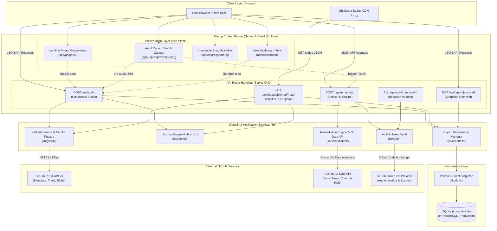
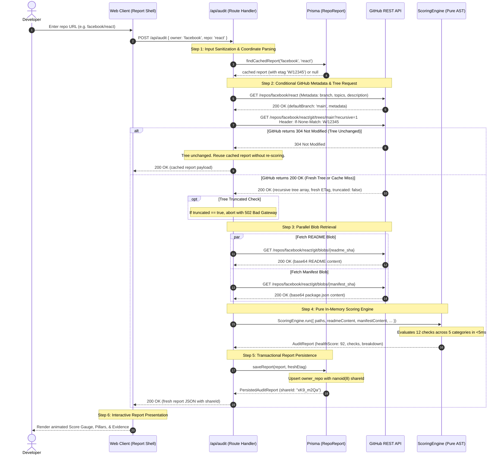

# Repodoc System Architecture

Repodoc is an engineering-first repository health auditor and automated remediation platform. It provides deterministic, defensible repository health scores across 12 rigorous checks, dynamic Shields.io badges, and 1-click atomic multi-file pull request remediations.

This document details Repodoc's end-to-end system topology, execution lifecycle, pure scoring engine mechanics, caching strategy, and security boundaries.

---

## 1. Executive System Topology

Repodoc is engineered around modern full-stack web standards, emphasizing deterministic domain logic, zero secret leakage, and single-roundtrip remote I/O:

- **Next.js 16 (16.4.0) with Turbopack & React 19 (19.3.0):** Leverages the Next.js App Router for server-rendered page shells, high-performance streaming, React Server Components (RSC), and edge-ready API route handlers.
- **Pure Scoring Engine (`lib/scoring/`):** A zero-network, deterministic domain service that evaluates repository health from memory structures using Abstract Syntax Tree (AST) markdown analysis and manifest heuristics.
- **GitHub Octokit Facade (`lib/github/`):** Encapsulated client managing single-call recursive Git tree traversals (`GET /git/trees/{sha}?recursive=1`), HTTP ETag conditional revalidations (`304 Not Modified`), and intelligent rate-limit throttling.
- **Atomic Remediation Engine (`lib/remediation/`):** Orchestrates low-level Git Data API operations (`blobs` &rarr; `tree` &rarr; `commit` &rarr; `ref`) to generate multi-file pull requests in a single atomic commit, featuring automated personal fork fallback for repositories without push permissions.
- **Prisma 6.x ORM (`lib/db.ts`):** Unified database persistence layer supporting embedded SQLite (`file:./dev.db`) for zero-friction local development and PostgreSQL (e.g. Neon, Supabase) with connection pooling in production.
- **Zero-Leak NextAuth.js v5 Beta (`lib/auth/`):** Session management utilizing AES-GCM encrypted JWT session cookies, isolating user OAuth tokens strictly on the server and preventing token leakage to browser runtimes.

```
Repodoc/
├── app/                           # Next.js 16 App Router (pages, layouts, API routes)
│   ├── api/                       # Server-only route handlers
│   │   ├── audit/route.ts         # POST: Trigger repository health audits
│   │   ├── badge/[owner]/[repo]/  # GET: Dynamic Shields.io badge endpoint
│   │   ├── report/[shareId]/      # GET: Immutable report snapshot by share ID
│   │   ├── remediate/route.ts     # POST: 1-click atomic PR generation
│   │   └── auth/[...nextauth]/    # NextAuth.js OAuth handler
│   ├── report/[owner]/[repo]/     # Dynamic live report presentation
│   ├── share/[shareId]/           # Immutable point-in-time snapshot view
│   ├── dashboard/                 # Authenticated user repository dashboard
│   ├── layout.tsx                 # Root layout & theme providers
│   └── page.tsx                   # Landing page, hero observatory & playground
├── components/                    # Reusable React 19 UI components
│   ├── landing/                   # Hero observatory, bento cards, step flows
│   ├── report/                    # Score gauges, category pillars, check rows
│   ├── dashboard/                 # Repository cards, health trends, toolbar
│   ├── auth/                      # Authentication gates and user profile controls
│   └── ui/                        # Accessible design primitives
├── lib/                           # Core business logic & domain services
│   ├── scoring/                   # Pure Rubric v1.0 engine, AST parser, checks
│   ├── github/                    # Octokit client facade, recursive tree traversal
│   ├── remediation/               # Git Data API orchestration, fork fallback
│   ├── templates/                 # Code templates (licenses, CI, gitignore, CoC)
│   ├── auth/                      # NextAuth configuration and token helpers
│   ├── reports.ts                 # Persistence manager, report upsert, nanoid
│   └── db.ts                      # Prisma client singleton
├── prisma/                        # Database schema and migrations
│   ├── schema.prisma              # Data models (User, RepoReport)
│   └── dev.db                     # Local SQLite database (development)
├── types/                         # Shared TypeScript ambient declarations
└── docs/                          # Technical deep dives and runbooks
```

> [!NOTE]
> Repodoc strictly adheres to a root directory structure without a `src/` prefix (`app/`, `components/`, `lib/`, `prisma/`, `types/`). All application paths are cleanly resolved via the `@/*` TypeScript path alias.

---

## 2. High-Level Architecture Diagram

The system maintains strict isolation between client components, route handlers, isolated domain engines, persistent data stores, and external GitHub APIs:



---

## 3. End-to-End Audit Lifecycle

Auditing a repository executes a high-speed, conditional pipeline designed to minimize upstream API calls and eliminate redundant scoring runs:



### Execution Step Details

1. **Input Sanitization & Validation (`app/api/audit/route.ts`):**  
   The handler normalizes inputs, accepting either plain `{ owner, repo }` strings or full GitHub URLs (`https://github.com/owner/repo`). Invalid characters or path traversal attempts (`.` or `..`) are rejected immediately with HTTP 400.
2. **Database Cache Lookup (`lib/reports.ts`):**  
   The server checks the local database for a pre-existing report using the unique composite key `(owner, repo)`. If a record exists with matching `RUBRIC_VERSION` and a stored `etag`, that ETag is retrieved.
3. **Conditional GitHub Metadata & Tree Query (`lib/github/`):**  
   - `fetchDefaultBranch`: Retrieves repository metadata (`default_branch`, `description`, `topics`).
   - `fetchRepoTree`: Directly requests `GET /repos/{owner}/{repo}/git/trees/{default_branch}?recursive=1` passing `If-None-Match: <etag>`. GitHub natively accepts branch references in tree endpoints, saving an extra Git ref lookup.
4. **ETag Revalidation & Truncated Tree Detection:**  
   - **304 Not Modified:** If the commit tree has not changed, GitHub responds with `304 Not Modified`. The API reuses the persisted report without wasting CPU cycles on re-scoring or hitting blob endpoints.
   - **200 OK:** GitHub returns the entire tree hierarchy as an array of `TreeEntry` objects along with a new `ETag`. If GitHub reports `truncated: true` (repositories exceeding 100,000 files or 7 MB of tree data), Repodoc returns HTTP 502 to prevent partial, inaccurate evaluations.
5. **Parallel Blob Retrieval:**  
   The tree is inspected for the primary README file (matching case-insensitive candidate paths: `README.md`, `README`, `.github/README.md`, `docs/README.md`, etc.) and the root package manifest (`package.json`). If present, their raw Git blobs are fetched in parallel using `GET /repos/{owner}/{repo}/git/blobs/{sha}` and decoded from UTF-8/Base64.
6. **Pure In-Memory Evaluation (`lib/scoring/`):**  
   The normalized path set, file contents, and repository metadata are passed to `ScoringEngine.run()`. All 12 checks evaluate in memory with zero external I/O.
7. **Transactional Upsert & Snapshot Generation:**  
   The resulting `AuditReport` is persisted to the database via `saveReport()`. For new records, an 8-character collision-resistant `nanoid` is generated as the immutable `shareId`.
8. **UI Presentation:**  
   The web client receives the complete `PersistedAuditReport` payload, animating the circular SVG health gauge, rendering category score bars, and highlighting failing checks with 1-click remediation actions.

---

## 4. Scoring Engine Architecture (`lib/scoring`)

The scoring engine implements **Rubric v1.0**, establishing a 100-point defensible baseline for open-source engineering excellence.

### Zero-Network Domain Isolation

The scoring engine is implemented as a set of pure, deterministic functions:
- **Zero External Network Calls:** The engine never performs `fetch`, database queries, or file-system reads.
- **Deterministic Output:** Identical inputs guaranteed to yield identical scores, check breakdowns, and evidence details.
- **Ultra-Fast Execution:** Average audit evaluation runs in under 5 milliseconds in-memory.

### Rubric v1.0 Check Specifications

The 100-point total score is distributed across 5 categories and 12 distinct checks:

| Category | Max Pts | Check ID | Pts | Automatable | Evaluation Criteria |
|:---|:---:|:---|:---:|:---:|:---|
| **Documentation** | **25** | `readme-presence` | 8 | No | Candidate README file located in root, `.github/`, or `docs/`. |
| | | `readme-headings` | 10 | No | AST markdown extraction verifying both **Installation/Setup** AND **Usage/Quickstart** headings. |
| | | `architecture-docs` | 4 | No | Architecture documentation file in root, `.github/`, or `docs/`. |
| | | `contributing-guide` | 3 | No | Contributing guidelines in root, `.github/`, or `docs/`. |
| **Project Hygiene** | **20** | `license` | 10 | **Yes** | Recognized open-source license file (MIT, Apache-2.0, BSD, GPL, MPL, etc.). |
| | | `gitignore` | 5 | **Yes** | `.gitignore` file present at repository root. |
| | | `code-of-conduct` | 5 | **Yes** | Contributor Covenant or standard Code of Conduct file. |
| **Testing & CI/CD** | **25** | `ci-workflow` | 15 | **Yes** | Automated GitHub Actions workflow (`.github/workflows/*.yml` or `*.yaml`). |
| | | `tests` | 10 | No | Test directories (`test/`, `tests/`, `__tests__/`, `spec/`), language test files (`*_test.go`, `*_test.rs`, `test_*.py`, `*.test.ts`), or `"test"` script in `package.json`. |
| **Community** | **15** | `issue-templates` | 4 | No | Issue templates in `.github/ISSUE_TEMPLATE/` or root `.github/ISSUE_TEMPLATE.md`. |
| | | `pr-template` | 4 | No | Pull request template in `.github/PULL_REQUEST_TEMPLATE/` or root `.github/PULL_REQUEST_TEMPLATE.md`. |
| | | `repo-metadata` | 7 | No | Non-empty GitHub repository description (4 pts) and repository topics (3 pts). |
| **Security Baseline**| **15** | `security-policy` | 10 | **Yes** | Vulnerability disclosure policy (`SECURITY.md` or `.github/SECURITY.md`). |
| | | `dependency-scanning` | 5 | No | Dependabot (`.github/dependabot.yml`) or Renovate (`renovate.json`, `.renovaterc`) configuration. |
| **Total** | **100** | | **100** | **5 Checks** | |

### AST Markdown Heading Extraction

Checking README quality requires semantic AST parsing rather than fragile line-by-line regex scanning. The heading extractor in `lib/scoring/checks/documentation.ts`:

1. **Strips Non-Heading Blocks:**
   - Strips fenced code blocks marked with triple backticks (```` ``` ````) or tildes (`~~~`).
   - Strips unclosed code blocks at end-of-file.
   - Strips HTML comments (`<!-- ... -->`).
   - *Rationale:* Prevents code comments (e.g. bash scripts `# ...` or Python comments) from false-matching as Markdown H1 headings.
2. **Extracts Multiple Heading Syntaxes:**
   - **ATX Headings:** Matches `^#{1,6}\s+(.+)$` with up to 3 spaces of indentation.
   - **Setext Headings:** Matches text lines followed by `===` (H1) or `---` (H2).
   - **HTML Headings:** Matches `<h1>` through `<h6>` tags.
3. **Normalizes Text:**
   - Strips inline formatting: bold (`**`, `__`), italics (`*`, `_`), inline code backticks (`` ` ``), and markdown links (`[title](url)` &rarr; `title`).
4. **Semantic Heuristic Matching:**
   - Evaluates headings against semantic regular expressions:
     - **Installation:** `/\b(installation|install|setup|getting[\s_-]*started)\b/i`
     - **Usage:** `/\b(usage|quickstart|quick[\s_-]*start|getting[\s_-]*started|how[\s_-]*to[\s_-]*use)\b/i`

### Context-Aware Manifest Heuristics

The engine incorporates project manifest awareness to avoid penalizing distinct project ecosystems:
- **JavaScript / TypeScript Projects:** Inspects `package.json` manifest content for configured `"scripts"` containing `"test"`, ensuring libraries and apps without standalone `test/` folders receive test configuration credit.
- **Compiled & Systems Languages:** Detects language-specific test naming patterns:
  - Go: `*_test.go`
  - Rust: `*_test.rs`
  - Python: `test_*.py` and `*_test.py`
  - JavaScript / TypeScript: `*.test.(ts|tsx|js|jsx)` and `*.spec.(ts|tsx|js|jsx)`

### Structured Evidence Model

Every evaluated check returns a strictly typed `CheckResult` object containing defensible evidence:

```typescript
export interface CheckResult {
  id: string;                     // e.g. "ci-workflow", "license"
  name: string;                   // Human-readable title
  category: CategoryId;           // "documentation" | "hygiene" | "testing_ci" | ...
  pointsAwarded: number;          // Points earned (bounded [0, maxPoints])
  maxPoints: number;              // Documented rubric weight
  passed: boolean;                // Binary pass/fail indicator
  evidence: {
    filesChecked: string[];       // Exhaustive list of checked candidate paths
    found: boolean;               // True if candidate matched
    details: string;              // Specific human-readable rationale
  };
  remediation?: {
    canAutomate: boolean;         // True if Repodoc can auto-generate a PR
    targetPath: string;           // Repository path for remediation file
    description: string;          // Actionable guidance for developer
    requiresUserInput?: "license_selection";
  };
}
```

---

## 5. Performance, Rate Limiting & Caching Strategy

Repodoc is designed to run efficiently against GitHub's public API limits while delivering sub-second response times.

### Git Tree Conditional Requests with ETags

Unauthenticated requests to the GitHub API are limited to **60 requests per hour per IP** (or 5,000 per hour with an authenticated token). Walking a repository directory structure file-by-file quickly exhausts this quota. Repodoc resolves this through two architectural decisions:

1. **Single-Call Recursive Tree Traversal:**  
   A single call to `GET /repos/{owner}/{repo}/git/trees/{defaultBranch}?recursive=1` returns the entire tree structure for the repository in a single roundtrip.
2. **HTTP ETag Conditional Revalidation:**  
   When an audit completes, the HTTP `ETag` returned by GitHub is saved alongside the report. Subsequent audit requests issue conditional HTTP requests with `If-None-Match: <etag>`. When the repository default branch has not changed, GitHub responds with `304 Not Modified`, consuming minimal rate-limit bandwidth and enabling Repodoc to serve the cached report instantly.

### Shields.io Dynamic Badge API & Edge Caching

Repodoc serves dynamic SVG badges conforming to the Shields.io Endpoint v1 specification at `GET /api/badge/[owner]/[repo]`.

- **Payload Format:**
  ```json
  {
    "schemaVersion": 1,
    "label": "repo health",
    "message": "92/100",
    "color": "brightgreen"
  }
  ```
- **CDN Edge Cache Headers:**  
  Responses include explicit HTTP cache-control directives:
  ```http
  Cache-Control: public, s-maxage=3600, stale-while-revalidate=86400
  ```
  - `s-maxage=3600`: Shields.io's Cloudflare edge CDN caches the badge response for 1 hour.
  - `stale-while-revalidate=86400`: If the badge expires, the CDN serves stale content for up to 24 hours while revalidating asynchronously in the background.
- **Score Color Thresholds:**
  - `90 - 100`: `brightgreen`
  - `75 - 89`: `green`
  - `60 - 74`: `yellow`
  - `40 - 59`: `orange`
  - `0 - 39`: `red`

### Immutable Share Snapshots

When users share reports (`/share/[shareId]`), the snapshot is retrieved via an 8-character URL-safe `nanoid` key (`[A-Za-z0-9_-]{8}`). Shared reports are immutable point-in-time snapshots:
- They never trigger background GitHub API revalidations.
- They remain readable even if the upstream repository is deleted or changed.
- They preserve the exact score and breakdown calculated under that specific rubric version.

---

## 6. Remediation Engine Integration (`lib/remediation`)

Repodoc's "Fix All" feature automates the remediation of failing checks, allowing users to generate pull requests across 5 supported checks (`license`, `gitignore`, `ci-workflow`, `security-policy`, `code-of-conduct`).

### Low-Level Git Data API Pipeline

Rather than issuing multiple branch commits via standard GitHub file APIs, Repodoc utilizes the low-level **Git Data API** to construct a single atomic commit:

```
Base Commit (HEAD)
       │
       ├──► 1. POST /git/blobs (Create raw Git blobs for each generated file)
       │
       ├──► 2. POST /git/trees (Construct new tree with base tree + new blobs)
       │
       ├──► 3. POST /git/commits (Create single commit referencing new tree & base commit)
       │
       ├──► 4. POST /git/refs (Create or update branch 'repodoc/health-remediation')
       │
       └──► 5. POST /pulls (Open Pull Request against upstream default branch)
```

This ensures that regardless of whether 1 or 5 files are being added, the repository receives exactly **one clean, bisectable commit** with an informative commit message.

### Automatic Personal Fork Fallback

When an authenticated user requests remediation for a repository where they lack direct push permissions:

1. **Permission Check:** The engine inspects user permissions via GitHub's API.
2. **Automated Fork Provisioning:** If direct push is unauthorized, Repodoc checks for an existing user fork or triggers `POST /repos/{owner}/{repo}/forks`.
3. **Commit Synchronization Polling:** The engine polls the newly created fork (up to 15 seconds with exponential backoff) until GitHub finishes replicating the base tree.
4. **Fork Commit & Cross-Repo PR:** The atomic commit is applied to `repodoc/health-remediation` on the user's personal fork, and a cross-repository pull request is opened against the original upstream repository.

---

## 7. Data Flow & Security Boundaries

### Server-Only Boundary Enforcement

All code interacting with external credentials, the database, or GitHub APIs is strictly isolated using Next.js 16 server-only barriers:

```typescript
import "server-only";
```

Modules such as `lib/github/client.ts`, `lib/remediation/engine.ts`, `lib/reports.ts`, and `lib/auth.ts` will produce build-time compilation errors if imported into any Client Component (`"use client"`).

### Zero-Leak Token Isolation

GitHub OAuth tokens obtained during sign-in are stored exclusively within AES-GCM encrypted JWT session cookies managed by NextAuth.js v5:
- **Browser Inaccessibility:** Tokens are omitted from the `/api/auth/session` endpoint and the client-side `useSession()` hook.
- **Server Execution Only:** Route handlers retrieve tokens via server-side session extraction (`getGitHubSession()`), ensuring user credentials are never exposed to browser memory or client-side scripts.

### Database Connection Lifecycle

The database connection is managed via the Prisma Client singleton in `lib/db.ts`:
- **Development (SQLite):** Reuses a single Prisma instance attached to `globalThis` across Next.js Hot Module Reload (HMR) cycles to prevent file lock contention on `dev.db`.
- **Production (PostgreSQL):** Connects to managed cloud databases (Neon, Supabase) using connection pooling strings (`?pgbouncer=true` or port 6543) to prevent connection exhaustion in serverless environments.
