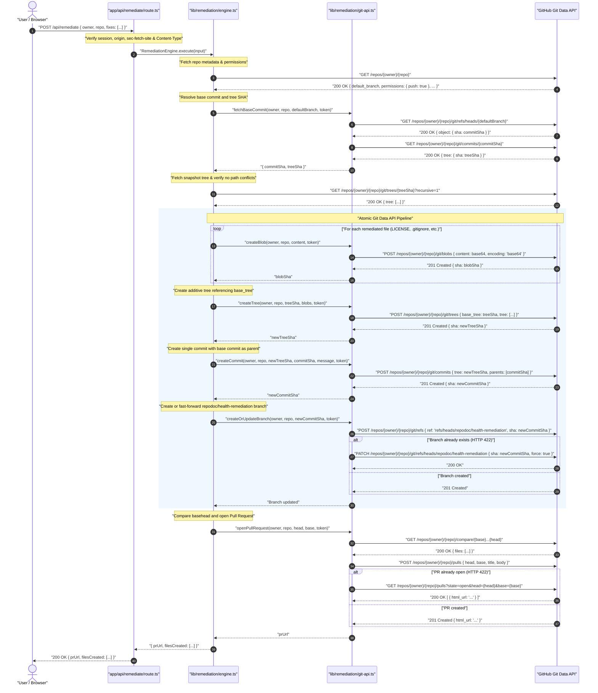
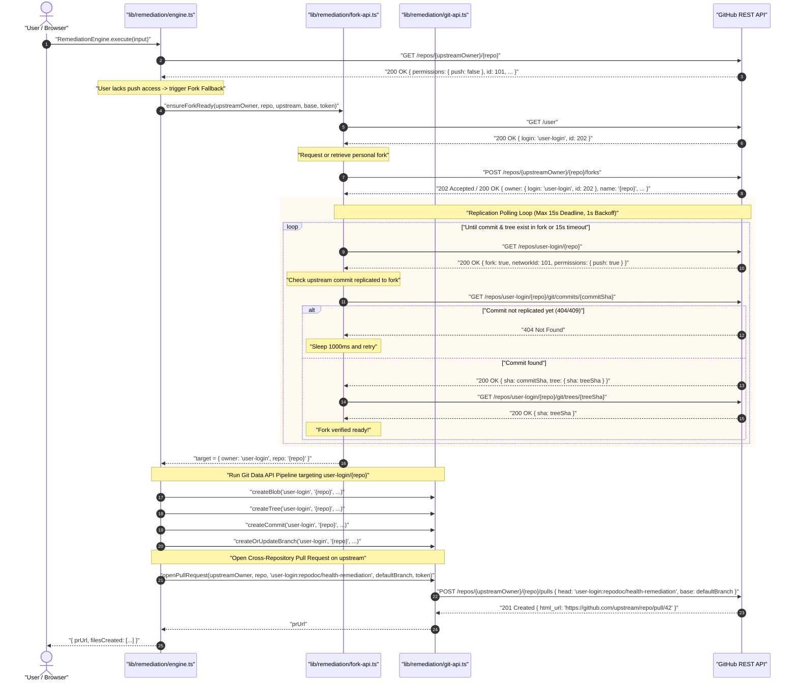

# Remediation Engine & Git Data API Architecture

Repodoc features an engineering-first, automated repository remediation platform ("Fix All"). Rather than requiring developers to manually generate configuration boilerplate or clone repositories locally, Repodoc synthesizes compliant repository assets and commits them directly to GitHub via the low-level **Git Data API**.

This document details the internal architecture of the remediation subsystem, the 5-stage atomic commit pipeline, automated personal fork fallbacks, template synthesis heuristics, security boundaries, and error recovery contracts.

---

## 1. Executive Summary & Capabilities

The remediation engine is designed around three non-negotiable principles:
1. **Atomic Multi-File Commits:** All selected remediations are committed in exactly **one** Git commit object. Repodoc never pollutes repository commit history with piecemeal file changes, nor does it leave target branches in half-remediated states if an operation fails.
2. **Zero-Clone Remote I/O:** All operations execute server-side via direct Octokit REST requests against the Git Data API. No local Git binaries, disk allocations, temporary clones, or filesystem cleanup routines are involved.
3. **Pure Server-Side Re-Verification:** Repodoc never trusts client-submitted audit reports or target file paths. When remediation is invoked, the engine performs a fresh server-side audit of the repository's default branch, verifies tree coordinates, detects path conflicts, and synthesizes immutable templates.

### 1.1 The 5 Automatable Checks

The engine provides 1-click remediation for five fundamental repository health checks:

| Check ID | Target Path | Synthesis Mechanism | Required User Inputs |
| :--- | :--- | :--- | :--- |
| `license` | `LICENSE` | Selects one of 5 canonical SPDX licenses with single-pass `{{year}}` and `{{fullname}}` attribution replacement. | `licenseChoice` (SPDX ID), `licenseFullName` (copyright holder), `licenseYear` (optional, defaults to current UTC year). |
| `gitignore` | `.gitignore` | Analyzes repository manifest basenames (`package.json`, `cargo.toml`, `go.mod`, `pyproject.toml`) and stitches official CC0 rules for detected ecosystems. Defaults to generic fallback. | None (derived deterministically from tree snapshot). |
| `ci-workflow` | `.github/workflows/ci.yml` | Evaluates manifests and test file conventions to generate a pinned, security-hardened GitHub Actions workflow with minimal read-only permissions. | None (derived deterministically from tree snapshot; targets repository `defaultBranch`). |
| `security-policy` | `SECURITY.md` | Synthesizes a structured security disclosure policy with supported version tables, private vulnerability reporting guidelines, and response SLA. | `projectName` (defaults to repo name), `contact` (optional email/URL), `responseSla` (defaults to "48 hours"). |
| `code-of-conduct` | `CODE_OF_CONDUCT.md` | Renders the canonical Contributor Covenant v2.1 text with guaranteed single-pass contact injection. | `codeOfConductContact` (email address or reporting URL). |

> [!NOTE]
> Target paths are hardcoded server-side constants. Client requests provide only the check identifiers (`fixes: ["license", "gitignore"]`); user input cannot manipulate target filenames or directory destinations.

---

## 2. Core File Topology & Responsibilities

The remediation subsystem is organized within the [`lib/remediation/`](file:///Users/aizen/Documents/Coding/NextJS/Repodoc/lib/remediation) domain directory, supported by template renderers in [`lib/templates/`](file:///Users/aizen/Documents/Coding/NextJS/Repodoc/lib/templates) and exposed via [`app/api/remediate/route.ts`](file:///Users/aizen/Documents/Coding/NextJS/Repodoc/app/api/remediate/route.ts):

```
Repodoc/
├── app/
│   └── api/
│       └── remediate/
│           └── route.ts          # POST handler: auth gate, CSRF verification, error mapping
├── lib/
│   ├── remediation/
│   │   ├── engine.ts             # Orchestrator: fresh audit, conflict check, pipeline flow
│   │   ├── git-api.ts            # Low-level Git Data API operations (blobs, trees, commits, refs, PRs)
│   │   ├── fork-api.ts           # Personal fork discovery, creation, and replication polling
│   │   └── errors.ts             # Typed RemediationError and error codes
│   ├── remediation-feedback.ts   # Public, user-friendly recovery error messages
│   └── templates/                # Pure synchronous template synthesis functions
│       ├── licenses/             # MIT, Apache-2.0, BSD-3-Clause, GPL-3.0, MPL-2.0
│       ├── gitignore/            # Node, Rust, Go, Python, Generic
│       ├── ci/                   # Ecosystem GitHub Actions workflows
│       ├── security/             # SECURITY.md template
│       └── conduct/              # Contributor Covenant v2.1
```

### Module Responsibilities

| File | Execution Boundary | Primary Responsibilities |
| :--- | :--- | :--- |
| [`engine.ts`](file:///Users/aizen/Documents/Coding/NextJS/Repodoc/lib/remediation/engine.ts) | Server-only (`import "server-only"`) | Coordinates end-to-end execution. Validates input coordinates and user tokens, queries repository permissions, fetches the default branch commit and tree SHA, detects path and ancestor directory conflicts, evaluates OAuth scopes, delegates to fork manager if unprivileged, and runs the Git Data API pipeline. |
| [`git-api.ts`](file:///Users/aizen/Documents/Coding/NextJS/Repodoc/lib/remediation/git-api.ts) | Server-only (`import "server-only"`) | Implements raw Octokit interactions against `/git/blobs`, `/git/trees`, `/git/commits`, `/git/refs`, and `/pulls`. Handles idempotent branch updating (`force: true`), PR comparisons with a 300-file safety ceiling, markdown filename escaping, and existing PR reconciliation upon HTTP 422. |
| [`fork-api.ts`](file:///Users/aizen/Documents/Coding/NextJS/Repodoc/lib/remediation/fork-api.ts) | Server-only (`import "server-only"`) | Inspects `permissions.push` on the target repository. If false, queries the authenticated user, triggers fork creation, verifies fork network integrity, and polls for upstream commit replication with a 15-second deadline and `AbortController`. |
| [`errors.ts`](file:///Users/aizen/Documents/Coding/NextJS/Repodoc/lib/remediation/errors.ts) | Server-only (`import "server-only"`) | Defines [`RemediationError`](file:///Users/aizen/Documents/Coding/NextJS/Repodoc/lib/remediation/errors.ts) with typed error codes (`invalid_input`, `path_conflict`, `no_changes`, `fork_not_ready`, `fork_conflict`, etc.). |
| [`route.ts`](file:///Users/aizen/Documents/Coding/NextJS/Repodoc/app/api/remediate/route.ts) | Route Handler (Edge/Node) | Enforces authentication via [`getGitHubSession()`](file:///Users/aizen/Documents/Coding/NextJS/Repodoc/lib/auth.ts), validates same-origin and `sec-fetch-site` headers, parses and validates JSON payloads, runs a fresh audit, and maps domain errors to standard HTTP status codes (400, 401, 403, 404, 409, 415, 429, 502, 503). |

---

## 3. Atomic Git Data API Pipeline

### 3.1 Why Not the Contents API?

GitHub provides a high-level Contents API (`PUT /repos/{owner}/{repo}/contents/{path}`). However, the Contents API has a critical limitation: **it commits only one file per API call**. 

If a user selects all 5 remediation fixes, using the Contents API would result in:
- 5 separate Git commits on the target branch.
- 5 distinct webhook triggers and CI run invocations.
- Risk of partial failures (e.g. if commit 3 succeeds but commit 4 hits a secondary rate limit, the branch is corrupted).
- Inability to verify that the base tree hasn't moved between file writes.

By leveraging GitHub's low-level **Git Data API**, Repodoc creates all file blobs independently, constructs a single additive tree object, points a single commit to that tree, and updates the branch reference in a single atomic step.

### 3.2 Direct Push Sequence Diagram

When the authenticated caller possesses direct write permissions to the repository (`repository.push === true`), the remediation engine follows the direct push pipeline:



### 3.3 Stage-by-Stage Breakdown

#### 1. Blob Creation (`POST /repos/{owner}/{repo}/git/blobs`)
For each file in the remediation payload, [`createBlob()`](file:///Users/aizen/Documents/Coding/NextJS/Repodoc/lib/remediation/git-api.ts#L294) serializes UTF-8 content to base64:
```typescript
const response = await octokit.rest.git.createBlob({
  owner: validatedOwner,
  repo: validatedRepo,
  content: Buffer.from(content, "utf8").toString("base64"),
  encoding: "base64",
});
return response.data.sha;
```
This stores the raw uncompressed content in the repository's object database without associating it with any directory tree or commit.

#### 2. Additive Tree Construction (`POST /repos/{owner}/{repo}/git/trees`)
In [`createTree()`](file:///Users/aizen/Documents/Coding/NextJS/Repodoc/lib/remediation/git-api.ts#L344), the engine posts the array of created blob SHAs with their repository-relative paths:
```typescript
const response = await octokit.rest.git.createTree({
  owner: validatedOwner,
  repo: validatedRepo,
  base_tree: validatedBaseTreeSha,
  tree: blobs.map((b) => ({ path: b.path, sha: b.sha, mode: "100644", type: "blob" })),
});
```
> [!IMPORTANT]
> The presence of `base_tree` makes tree creation **additive**. GitHub automatically inherits all existing files, subdirectories, and mode flags from `validatedBaseTreeSha`. Only the explicitly declared paths are overwritten or inserted. Unchanged files are never re-uploaded.

#### 3. Single Commit Creation (`POST /repos/{owner}/{repo}/git/commits`)
In [`createCommit()`](file:///Users/aizen/Documents/Coding/NextJS/Repodoc/lib/remediation/git-api.ts#L420), the engine binds the new tree to the exact parent commit:
```typescript
const response = await octokit.rest.git.createCommit({
  owner: validatedOwner,
  repo: validatedRepo,
  tree: validatedTreeSha,
  parents: [validatedParentSha],
  message: "chore(repodoc): resolve repository health audit findings",
});
```
This creates a single, clean commit containing all changes simultaneously.

#### 4. Idempotent Branch Reference Management (`POST` / `PATCH /git/refs`)
The engine targets a standardized branch name defined in [`lib/constants.ts`](file:///Users/aizen/Documents/Coding/NextJS/Repodoc/lib/constants.ts):
```typescript
export const REPODOC_BRANCH = "repodoc/health-remediation";
```
In [`createOrUpdateBranch()`](file:///Users/aizen/Documents/Coding/NextJS/Repodoc/lib/remediation/git-api.ts#L228):
1. The engine attempts `octokit.rest.git.createRef` pointing `refs/heads/repodoc/health-remediation` to the new commit SHA.
2. If GitHub responds with `422 Unprocessable Entity` (indicating the ref already exists from an earlier audit), the engine catches the error and executes `octokit.rest.git.updateRef` with `force: true`.
3. This guarantees that re-running remediation always overwrites previous stale remediation branches without requiring manual branch deletion.

#### 5. Pull Request Opening & Reconciliation (`POST /repos/{owner}/{repo}/pulls`)
In [`openPullRequest()`](file:///Users/aizen/Documents/Coding/NextJS/Repodoc/lib/remediation/git-api.ts#L103):
1. **Diff Comparison:** Compares `basehead` (`base...head`) using `octokit.rest.repos.compareCommitsWithBasehead`.
2. **Safety Ceiling:** If GitHub returns `files.length >= 300`, the comparison is rejected because GitHub's compare API paginates at 300 files and may return an incomplete file list.
3. **Markdown Escaping:** Filenames listed in the PR description are passed through [`escapeFilename()`](file:///Users/aizen/Documents/Coding/NextJS/Repodoc/lib/remediation/git-api.ts#L94), which replaces characters like `&`, `<`, `>`, `"`, `'`, and markdown symbols with decimal entities `&#...;` to prevent Markdown or HTML injection.
4. **Idempotent 422 Handling:** If `pulls.create` returns `422`, an existing PR is likely already open for that branch. The engine paginates through `pulls.list({ state: "open" })`, identifies the matching PR by head owner, head branch, and base branch, and returns the existing PR's HTML URL.

---

## 4. Automatic Personal Fork Fallback

### 4.1 The Open Source Remediation Dilemma

A significant portion of Repodoc's value lies in auditing public open-source repositories where the scanning user has no push access. Standard Git workflows fail when an unprivileged user attempts to create branches on upstream repositories.

Rather than failing with an unhelpful `403 Forbidden` error, Repodoc implements an automated **Personal Fork Fallback**:

```
                              User lacks push access?
                                        │
                                        ├─── NO  ──► Direct Push Pipeline (Section 3)
                                        │
                                        └─── YES ──► Fork Fallback Flow:
                                                      1. Find or create personal fork
                                                      2. Verify fork network integrity
                                                      3. Poll until upstream commit replicates
                                                      4. Commit changes to fork branch
                                                      5. Open cross-repository PR
```

### 4.2 Fork Fallback Sequence Diagram



### 4.3 Fork Readiness & Polling Contract

When GitHub forks a repository, the action is asynchronous. The fork metadata record may become accessible before the underlying Git object storage is replicated. Attempting to create a tree or commit against a fork before upstream commits exist causes `404 Not Found` or `422 Unprocessable Entity` errors.

[`ensureForkReady()`](file:///Users/aizen/Documents/Coding/NextJS/Repodoc/lib/remediation/fork-api.ts#L105) implements a strict readiness contract:
1. **Network Integrity Verification:**
   - Verifies `fork.owner.id === user.id` and `fork.owner.login === user.login`.
   - Confirms `fork.fork === true` and `fork.id !== upstream.repositoryId`.
   - Verifies `fork.networkId === upstream.networkId` to guarantee the fork belongs to the same repository network and can target upstream in a pull request.
   - Ensures the fork's default branch is not named `repodoc/health-remediation`.
2. **Isolated Polling Client:**
   - Uses `createOctokit(token, { maxRetries: 0 })` to bypass client-level retry delays and retain strict control over the polling cadence.
3. **15-Second Deadline with `AbortController`:**
   - Wraps the polling loop in `Promise.race([poll(), deadline])` with a 15,000ms timeout.
   - If the timeout fires, the `AbortController` terminates any in-flight HTTP requests and raises:
     ```typescript
     new RemediationError("fork_not_ready", "GitHub is still preparing the fork. Try again shortly.");
     ```
   - In [`route.ts`](file:///Users/aizen/Documents/Coding/NextJS/Repodoc/app/api/remediate/route.ts#L205), `fork_not_ready` is translated to an **HTTP 503 Service Unavailable** response with a `Retry-After: 15` header.
4. **Git Object Verification:**
   - In each polling iteration (with a 1,000ms delay), the engine attempts to fetch the base commit (`getCommit`) and base tree (`getTree`) directly from the fork coordinates.
   - Only when both objects return HTTP 200 with matching SHA hashes is the fork declared ready for writing.

---

## 5. Remediation Templates & Customization

All template synthesis occurs within pure, synchronous domain modules in [`lib/templates/`](file:///Users/aizen/Documents/Coding/NextJS/Repodoc/lib/templates). The generators execute without network or filesystem calls, producing deterministic outputs.

### 5.1 Licenses (`lib/templates/licenses/`)

[`renderLicense(spdxId, year, fullName)`](file:///Users/aizen/Documents/Coding/NextJS/Repodoc/lib/templates/licenses/index.ts#L42) supports 5 industry-standard open-source licenses:

| SPDX Identifier | License Name | Target Path | Replacement Tokens |
| :--- | :--- | :--- | :--- |
| `MIT` | MIT License | `LICENSE` | `{{year}}`, `{{fullname}}` |
| `Apache-2.0` | Apache License 2.0 | `LICENSE` | `{{year}}`, `{{fullname}}` |
| `BSD-3-Clause` | BSD 3-Clause "New" or "Revised" | `LICENSE` | `{{year}}`, `{{fullname}}` |
| `GPL-3.0-only` (or `GPL-3.0`) | GNU General Public License v3.0 | `LICENSE` | `{{year}}`, `{{fullname}}` |
| `MPL-2.0` | Mozilla Public License 2.0 | `LICENSE` | Static canonical text (SPDX-compliant) |

#### Validation Guarantees
- **Strict SPDX ID Check:** Throws `TypeError` if `spdxId` is not in [`SUPPORTED_LICENSE_IDS`](file:///Users/aizen/Documents/Coding/NextJS/Repodoc/lib/templates/licenses/index.ts#L18). The engine never picks a default license on behalf of the user.
- **Year Bounds:** Requires an integer between `1000` and `9999`.
- **Single-Line Attribution:** Requires a non-blank string without newlines (`/[\r\n\u2028\u2029]/`) to prevent header injection in license text.
- **Single-Pass Replacement:** Employs regex replacement with a replacer function to avoid interpreting `$` tokens as substitution patterns.

---

### 5.2 .gitignore Synthesis (`lib/templates/gitignore/`)

[`renderGitignore(paths)`](file:///Users/aizen/Documents/Coding/NextJS/Repodoc/lib/templates/gitignore/index.ts#L100) dynamically inspects the repository's path set and detects project ecosystems:

```typescript
const manifests: Record<string, GitignoreLanguage> = {
  "package.json": "node",
  "cargo.toml": "rust",
  "go.mod": "go",
  "setup.py": "python",
  "pyproject.toml": "python",
};
```

#### Multi-Ecosystem Stitching
If a repository contains multiple manifests (e.g. a polyglot monorepo containing both a Node frontend and a Python backend), [`detectLanguages()`](file:///Users/aizen/Documents/Coding/NextJS/Repodoc/lib/templates/gitignore/index.ts#L77) detects both and combines their rules in a deterministic order:
```
# Node
node_modules/
npm-debug.log*
...

# Python
__pycache__/
*.py[cod]
*$py.class
...
```
If no manifests are recognized, the engine renders [`GENERIC_GITIGNORE`](file:///Users/aizen/Documents/Coding/NextJS/Repodoc/lib/templates/gitignore/generic.ts) covering OS artifacts (`.DS_Store`, `Thumbs.db`, editor swap files). All templates are sourced from GitHub's official `.gitignore` repository under CC0-1.0.

---

### 5.3 Automated CI Workflow (`lib/templates/ci/`)

[`generateCIWorkflow(paths, { defaultBranch })`](file:///Users/aizen/Documents/Coding/NextJS/Repodoc/lib/templates/ci/index.ts#L207) targets `.github/workflows/ci.yml`. It applies a two-tier heuristic:

1. **Manifest & Lockfile Scan:**
   - Node: `package.json`, `package-lock.json`, `pnpm-lock.yaml`, `yarn.lock`, `bun.lockb`, `bun.lock`.
   - Python: `pyproject.toml`, `setup.py`, `setup.cfg`, `requirements.txt`, `Pipfile`, `poetry.lock`.
   - Go: `go.mod`, `go.sum`.
   - Rust: `cargo.toml`, `cargo.lock`.
2. **Test File Convention Fallback:**
   - Scans for `*.test.ts`, `*_test.py`, `*_test.go`, `*_test.rs` if manifests are missing or ambiguous.
3. **Security-Hardened Defaults:**
   - Explicit read-only top-level permissions:
     ```yaml
     permissions:
       contents: read
     ```
   - Standard runner: `ubuntu-latest`.
   - Pinned actions: `actions/checkout@v4`, `actions/setup-node@v4` (with auto-detected package manager caching), `actions/setup-python@v5`, `actions/setup-go@v5`, and `dtolnay/rust-toolchain@stable`.
   - Trigger configuration bound to the repository's detected default branch:
     ```yaml
     on:
       push:
         branches: [main]
       pull_request:
         branches: [main]
     ```

---

### 5.4 Security Policy (`lib/templates/security/`)

[`renderSecurityPolicy(options)`](file:///Users/aizen/Documents/Coding/NextJS/Repodoc/lib/templates/security/index.ts#L98) targets `SECURITY.md` and generates:
- **Supported Versions Table:** Standardized Markdown table outlining active version support windows.
- **Reporting Instructions:** Directs security researchers to GitHub Private Vulnerability Reporting if available, or incorporates user-specified contact methods (email or disclosure URL).
- **Response SLA:** Clearly defines initial triage and acknowledgment expectations (defaults to "48 hours").

---

### 5.5 Code of Conduct (`lib/templates/conduct/`)

[`renderCodeOfConduct(options)`](file:///Users/aizen/Documents/Coding/NextJS/Repodoc/lib/templates/conduct/index.ts#L30) targets `CODE_OF_CONDUCT.md`. It injects the official, unedited text of the **Contributor Covenant v2.1**.

The engine strictly mandates a reporting contact (`codeOfConductContact`). The placeholder `[INSERT CONTACT METHOD]` is replaced via:
```typescript
return CONTRIBUTOR_COVENANT_V2_1.replace(
  DEFAULT_CONTACT_PLACEHOLDER,
  () => contactMethod,
);
```
Passing a function to `.replace()` prevents replacement pattern interpretation (such as `$1` or `$&`) if the contact string contains special characters.

---

## 6. Security Guarantees & Scope Governance

### 6.1 OAuth Scope Governance

Repodoc verifies that the caller's GitHub token carries sufficient authorization before executing any write operations:

| Required Scope | Condition | Error Code | HTTP Status |
| :--- | :--- | :--- | :--- |
| `public_repo` (or `repo`) | Mandatory for all remediation pull requests. | `repository_scope_required` | 403 Forbidden |
| `workflow` | Mandatory if `ci-workflow` (`.github/workflows/ci.yml`) is among the selected fixes. | `workflow_scope_required` | 403 Forbidden |

#### Scope Inspection Mechanics
In [`engine.ts`](file:///Users/aizen/Documents/Coding/NextJS/Repodoc/lib/remediation/engine.ts#L247), the engine inspects the `x-oauth-scopes` header returned by GitHub when fetching repository metadata:
- If OAuth scopes are present and lack `public_repo` / `repo`, the engine immediately halts with [`REMEDIATION_FEEDBACK.repository_scope_required`](file:///Users/aizen/Documents/Coding/NextJS/Repodoc/lib/remediation-feedback.ts#L3).
- If `ci-workflow` is selected and scopes lack `workflow`, the engine halts with [`REMEDIATION_FEEDBACK.workflow_scope_required`](file:///Users/aizen/Documents/Coding/NextJS/Repodoc/lib/remediation-feedback.ts#L5).
- **Fine-Grained Personal Access Tokens (PATs):** Fine-grained tokens and GitHub Apps omit the `x-oauth-scopes` header. In these cases, the engine proceeds and allows GitHub to enforce granular permissions directly.

### 6.2 CSRF & Origin Defense

The remediation endpoint ([`POST /api/remediate`](file:///Users/aizen/Documents/Coding/NextJS/Repodoc/app/api/remediate/route.ts)) implements multi-layered request verification:
1. **Origin Verification:** Checks `request.headers.get("origin")`. If present, it must strictly match `new URL(request.url).origin`.
2. **Fetch Metadata Protection:** Inspects `sec-fetch-site`. Requests marked as `"cross-site"` are rejected immediately with HTTP 403.
3. **Content-Type Enforcement:** Validates `request.headers.get("content-type")`. Must be `application/json` (HTTP 415 otherwise).
4. **Session Cookie Decryption:** Calls [`getGitHubSession()`](file:///Users/aizen/Documents/Coding/NextJS/Repodoc/lib/auth.ts) to decrypt the AES-GCM JWT session cookie. If no active session exists, returns HTTP 401.

### 6.3 Safe Path Conflict & Overwrite Prevention

Repodoc **never** overwrites existing files. Before committing, the engine validates the live repository tree:
1. **Target Path Conflict:** Queries the tree snapshot to ensure the target path does not exist. If an entry already exists at the destination, it must be an automatable check that currently fails; non-regular files (e.g. symlinks, submodules) trigger `path_conflict` (HTTP 409).
2. **Ancestor Directory Conflict:** For nested paths like `.github/workflows/ci.yml`, the engine splits the path and inspects each segment (`.github`, `.github/workflows`). If any ancestor exists as a regular file or submodule rather than a Git tree (`mode: "040000"`), the engine throws `path_conflict` (HTTP 409).
3. **No Changes Detection:** If all selected checks already pass on the live branch, the engine aborts with `no_changes` (HTTP 409) rather than creating an empty commit.

---

## 7. Error Handling & HTTP Status Mapping

The remediation API maps domain exceptions to standardized HTTP responses:

| HTTP Status | Exception / Error Code | Root Cause | Client Response / Header |
| :---: | :--- | :--- | :--- |
| **400** | `InvalidRequestError`<br/>`InvalidRepositoryError`<br/>`RemediationError("invalid_input")` | Malformed JSON body, invalid repository coordinates, missing required template fields, or unsupported check IDs. | `{ error: "Selected fixes must be failed, supported automatable checks with valid template inputs..." }` |
| **401** | `getGitHubSession() === null`<br/>`GitHubApiError("unauthorized")` | Unauthenticated caller, missing session cookie, or revoked GitHub access token. | `{ error: "Sign in with GitHub to create a remediation pull request." }` |
| **403** | `origin !== request.url`<br/>`sec-fetch-site: cross-site` | Cross-origin request attempt or CSRF violation. | `{ error: "Cross-origin remediation requests are not allowed." }` |
| **403** | `RemediationError("repository_scope_required")` | Token lacks `public_repo` or `repo` scope. | `{ error: "...", code: "repository_scope_required" }` |
| **403** | `RemediationError("workflow_scope_required")` | Token lacks `workflow` scope when adding CI workflow. | `{ error: "...", code: "workflow_scope_required" }` |
| **403** | `GitHubApiError("forbidden")` | GitHub organization IP restriction, SAML enforcement, or push block. | `{ error: "GitHub denied the pull request operation..." }` |
| **404** | `GitHubApiError("not_found")` | Repository does not exist, was renamed, or caller lacks read access. | `{ error: "GitHub repository or resource was not found or is inaccessible." }` |
| **409** | `RemediationError("path_conflict")` | Destination path or parent directory conflicts with an existing file or submodule. | `{ error: "A remediation path conflicts with an existing repository entry..." }` |
| **409** | `RemediationError("no_changes")` | All selected findings have already been resolved on the upstream branch. | `{ error: "All selected remediation findings are already resolved. Refresh the audit." }` |
| **409** | `RemediationError("fork_conflict")` | Existing fork has incompatible network ID, belongs to another user, or default branch is invalid. | `{ error: "Your fork cannot safely be used for remediation..." }` |
| **415** | Content-Type check failed | Client omitted `Content-Type: application/json`. | `{ error: "Content-Type must be application/json." }` |
| **429** | `GitHubApiError("rate_limited")` | GitHub REST API secondary or primary rate limit exceeded. | `{ error: "GitHub API rate limit exceeded..." }`<br/>Includes `Retry-After: <seconds>` header. |
| **502** | `IncompleteTreeError`<br/>`GitHubApiError("invalid_response")` | GitHub returned a truncated tree (`truncated: true`) or malformed Git Data response. | `{ error: "GitHub did not return a complete repository tree. Remediation is unavailable." }` |
| **503** | `RemediationError("fork_not_ready")` | GitHub fork creation or Git object replication did not complete within the 15s deadline. | `{ error: "GitHub is still preparing your fork..." }`<br/>Includes `Retry-After: 15` header. |
| **500** | Uncaught Exception | Unhandled internal server error. | `{ error: "Unable to complete repository remediation." }` |

---

## 8. Testing & Verification Runbook

Repodoc maintains comprehensive test coverage across all remediation and template subsystems, verified by **Vitest** (`^5.0.3`):

### 8.1 Test Suite Structure

| Test File | Focus Area | Test Count |
| :--- | :--- | :---: |
| [`lib/remediation/__tests__/git-api.test.ts`](file:///Users/aizen/Documents/Coding/NextJS/Repodoc/lib/remediation/__tests__/git-api.test.ts) | Mocked Octokit interactions: blob creation, additive tree creation, commit linking, branch updating, 300-file ceiling rejection, and filename escaping. | 375 tests |
| [`lib/remediation/__tests__/engine.test.ts`](file:///Users/aizen/Documents/Coding/NextJS/Repodoc/lib/remediation/__tests__/engine.test.ts) | Orchestration: re-audit verification, path conflict detection, parent directory validation, OAuth scope checking, and direct push execution. | 78 tests |
| [`lib/remediation/__tests__/fork-api.test.ts`](file:///Users/aizen/Documents/Coding/NextJS/Repodoc/lib/remediation/__tests__/fork-api.test.ts) | Fork fallback: fork creation, ownership checks, network ID matching, 15s deadline timeout, and Git object replication polling. | 54 tests |
| [`lib/remediation/__tests__/fork-engine.test.ts`](file:///Users/aizen/Documents/Coding/NextJS/Repodoc/lib/remediation/__tests__/fork-engine.test.ts) | End-to-end remediation flow when push access is denied, verifying fork target resolution and cross-repository PR generation. | 20 tests |
| [`lib/remediation/__tests__/base-commit.test.ts`](file:///Users/aizen/Documents/Coding/NextJS/Repodoc/lib/remediation/__tests__/base-commit.test.ts) | Base commit and tree SHA resolution, reference validation, and error handling. | 23 tests |
| [`app/api/remediate/__tests__/route.test.ts`](file:///Users/aizen/Documents/Coding/NextJS/Repodoc/app/api/remediate/__tests__/route.test.ts) | HTTP endpoint: session gates, CORS/origin checking, JSON schema validation, and status code mapping. | 115 tests |
| [`app/api/remediate/__tests__/route.integration.test.ts`](file:///Users/aizen/Documents/Coding/NextJS/Repodoc/app/api/remediate/__tests__/route.integration.test.ts) | End-to-end integration tests through the Next.js Route Handler interface. | 11 tests |
| [`lib/templates/`](file:///Users/aizen/Documents/Coding/NextJS/Repodoc/lib/templates) (`ci`, `conduct`, `gitignore`, `licenses`, `security`) | Unit tests for pure template generators, input bounds, ecosystem detection, and token replacement. | 180 tests |

### 8.2 Execution Command

To execute all remediation and template test suites:

```bash
bun run test:run lib/remediation app/api/remediate lib/templates
```

To run remediation tests in watch mode during development:

```bash
bunx vitest lib/remediation app/api/remediate
```
